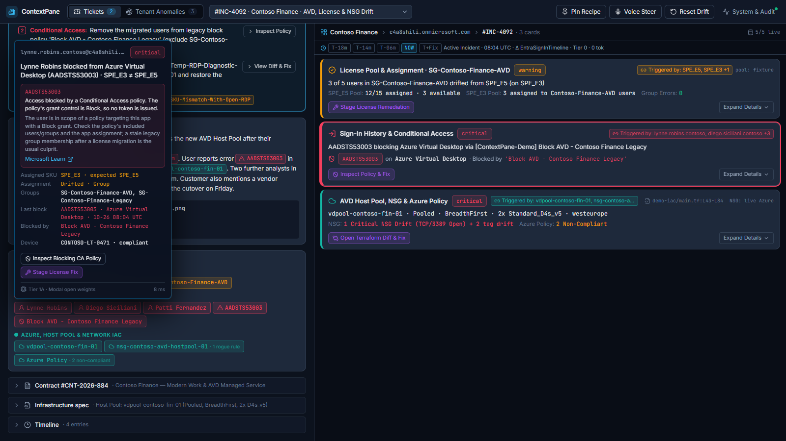
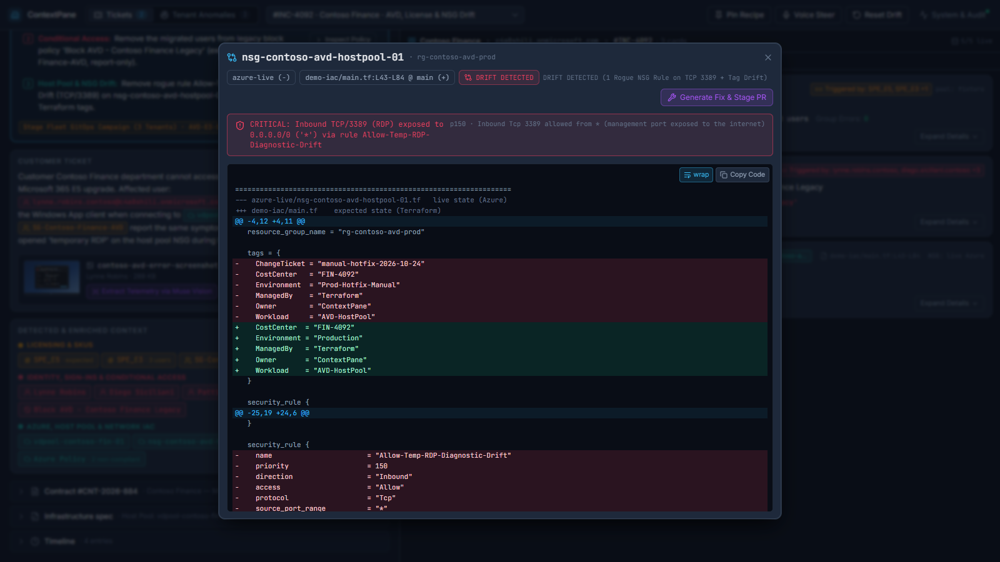
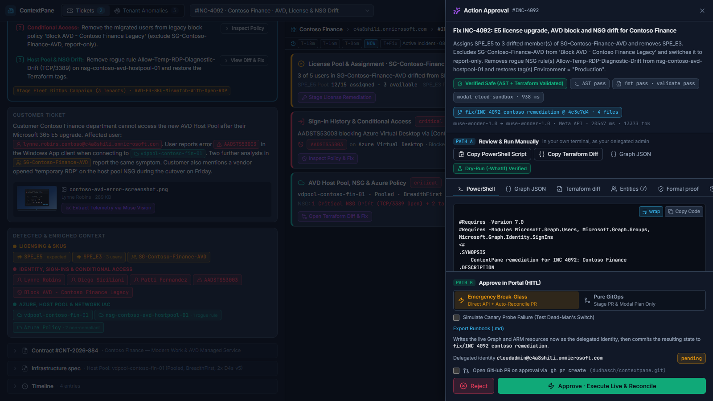
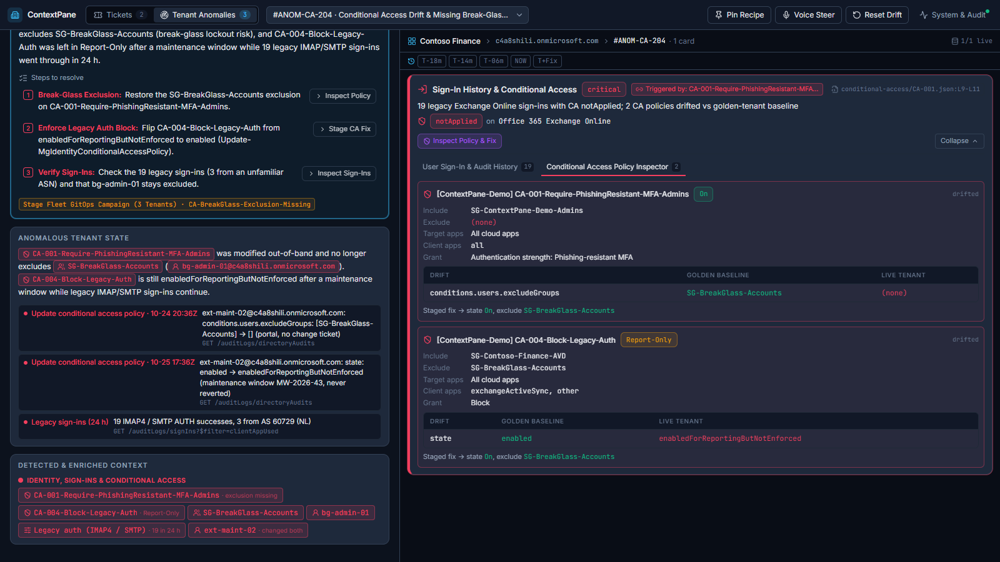
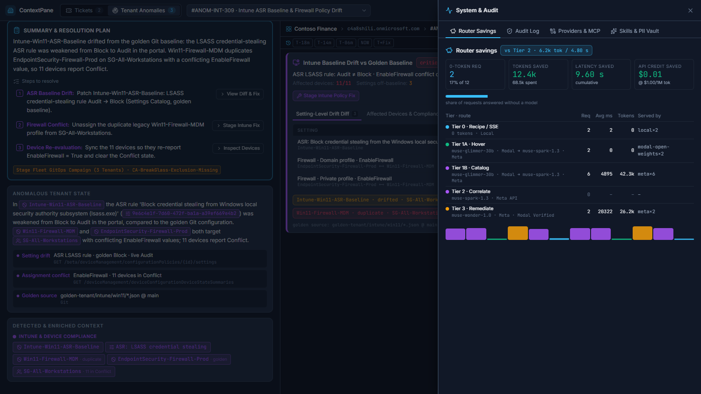
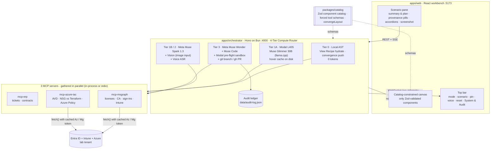

# ContextPane

**A local-first, MCP-driven, catalog-constrained Generative UI workbench for MSP Azure & Microsoft 365 engineers.**

Built from scratch for the **Meta Global AI Developer Hackathon** (Oct 26 – Nov 4, 2026),
*Build for Your World* track. See [`HACKATHON_ATTRIBUTION.md`](./HACKATHON_ATTRIBUTION.md).

ContextPane takes a commercial ERP escalation ticket or a proactive tenant anomaly, correlates
it live against Entra ID (licenses, Conditional Access, sign-in logs), Intune (Settings Catalog,
device configurations) and Azure (AVD, NSG drift vs. Terraform, Azure Policy), and renders the
answer as **Zod-validated UI components, never chat prose**. A 4-tier compute
router makes sure the cheapest possible path answers each request: a pinned View Recipe
costs **0 tokens and <150 ms**, an inline hover costs one `muse-glimmer-30b` / `muse-spark-1.3` call, and
only an explicit *Generate Fix* click escalates to `muse-wonder-1.0` with a
verifiable pre-flight sandbox and a Human-in-the-Loop approval drawer.

| | |
|---|---|
|  |  |
| **1 · Ticket mode + inline hover.** INC-4092's left pane opens with the Summary & Resolution Plan and the *Detected & Enriched Context* pills, coloured by provenance (amber licensing, rose identity / CA, violet Intune, teal Azure). Hovering Lynne's UPN opens the `HoverDiagnosticPopover` from the Muse Glimmer 30B cache: assigned vs expected SKU, assignment state, group memberships and the last AADSTS53003 block with its policy, plus `[Inspect Blocking CA Policy]` and `[Stage License Fix]`. | **2 · IaC diff.** The live `nsg-contoso-avd-hostpool-01` in Azure against `demo-iac/main.tf`: tag drift plus a rogue RDP rule open to `*`. |
|  |  |
| **3 · Tier 3 HITL drawer.** `muse-wonder-1.0` wrote the PowerShell + Terraform bundle and the pre-flight (PowerShell AST, static `-WhatIf` proof, `terraform fmt` + `validate`) says **Verified Safe**. Path A copies the script or the Terraform with a `[Dry-Run (-WhatIf) Verified]` badge; Path B approves it as **Emergency Break-Glass** (live write + reconcile commit) or **Pure GitOps** (PR and sandbox plan only). The fix is staged on `fix/INC-4092-contoso-remediation`. | **4 · Tenant anomaly.** ANOM-CA-204: step 1 of the plan expands the Conditional Access card on its policy tab. CA-001 lacks the break-glass exclusion and CA-004 is still Report-Only; the CodeLens in the card header (`conditional-access/CA-001.json:L9-L11`) opens the diff against the golden baseline. |
|  | |
| **5 · Zero-token recipe switch.** The canvas pinned on ANOM-CA-204 re-hydrates ANOM-INT-309 (ASR rule in Audit, firewall conflict on 11 devices) through Tier 0 with 0 LLM tokens; the System & Audit drawer tallies the router savings per tier. | |

Screenshots are 1600×900 captures of the live workbench (`bun run scripts/capture-readme-screenshots.ts`).

## Tickets and tenant anomalies

The top bar switches between two modes. **Tickets** are customer escalations from the ERP;
**Tenant Anomalies** are drifts found proactively in the managed tenant. Every scenario renders only
the cards it needs, compact by default, each with a `border-l-4` accent and a *Triggered by* badge
in the colour of the left-pane entities that spawned it. Hovering a pill rings its card and dims the
others; clicking it expands the card on the matching tab.

| Scenario | Tenant | What drifted | Cards | Fix |
|---|---|---|---|---|
| **INC-4092** | Contoso Finance | 3 AVD users on SPE_E3 instead of SPE_E5, AADSTS53003 from the legacy CA block, NSG tag drift and a rogue RDP rule | License · Sign-ins / CA · AVD / NSG / Azure Policy | License extension + Terraform |
| **INC-4099** | Fabrikam Legal | BitLocker `0x87D1FDE8`: a 2024 device configuration conflicts with the disk encryption baseline, devices non-compliant, AADSTS53000 | Intune · Sign-ins / CA | Unassign the legacy profile |
| **ANOM-LIC-101** | Contoso Finance | 15/15 SPE_E5 seats used (CountViolation for 2 new hires) while 3 disabled leavers still hold E5 + Copilot | License | Reclaim the orphaned seats |
| **ANOM-CA-204** | Contoso Finance | CA-001 (phishing-resistant MFA for admins) has no break-glass exclusion; CA-004 (block legacy auth) left in Report-Only | Sign-ins / CA | Exclude SG-BreakGlass-Accounts, enforce CA-004 |
| **ANOM-INT-309** | Contoso Finance | ASR rule *Block credential stealing from LSASS* is Audit instead of Block; a legacy firewall profile conflicts on 11 devices | Intune | ASR rule to Block, unassign the duplicate profile |

The left pane holds the Summary & Resolution Plan (numbered steps; clicking one focuses its card and
tab), the ticket or anomaly text with inline pills, the *Detected & Enriched Context* pills grouped by
provenance, and the contract and infrastructure spec in collapsed accordions.

## Day-2 architectural upgrades

Four upgrades, all kept off the main canvas cards (see `DESIGN.md`):

1. **Tier 3C Formal Blast-Radius Prover** (`apps/orchestrator/src/local/formal-verifier.ts`, Python mirror `modal-sandbox/app.py`): a deterministic symbolic prover (<100 ms, no GPU) proves break-glass non-lockout, target Blocked→Allowed remediation, and NSG 5-tuple reachability (`Internet→AVDSubnet TCP/3389` empty, AVD control plane 443 intact) before Approve unlocks. `GET /api/formal/:scenarioId` returns the proof, the 30-day counterfactual Blast-Radius Matrix, the pre-verified inverse rollback bundle `f⁻¹`, and the `f(f(S)) = f(S)` copy-on-write idempotency check. The matrix, proof and `[Inverse Rollback (f⁻¹)]` tab live inside the Action Approval drawer; converged canvases get a `[1-Click Undo / Rollback (f⁻¹)]` button (`POST /api/rollback`, <1 s).
2. **Tier 3 → Tier 0 Skill Compiler** (`apps/orchestrator/src/local/skill-compiler.ts`): `POST /api/skills/compile` captures the verified execution trace, runs a 100-case property fuzzer (tenant IDs, user/SKU counts, groups, policy IDs; 100/100 Zod-valid + formally verified), and promotes the skill to `data/compiled-skills.json`. Later matches run at Tier 0 (0 tokens, <2 ms) with a `Tier 0 Compiled Skill (100/100 fuzz verified)` badge in System & Audit.
3. **Bi-Temporal Time-Travel Scrubber** (`GET /api/timeline/:scenarioId`): 4–5 `[valid_from, valid_to]` causal slices per scenario (INC-4092: `T-18m` healthy → `T-14m` drift → `T-06m` first `AADSTS53003` → `NOW` → `T+Fix` counterfactual), rendered as one pill bar above the cards. Scrubbing re-hydrates at Tier 0 in <2 ms and rings the changed card.
4. **`ptr://` v2 + PII Pseudonym Vault** (`packages/catalog/src/dataplane.ts`): relational projections such as `ptr://inc-4092/entra/users?where=driftStatus:drifted&select=upn,currentSku,expectedSku&order=upn` (invalid queries fail closed), and `@pii(classification: "EU-GDPR-Personal")` fields (`upn`, `displayName`, `ipAddress`, `userId`, `deviceName`) vaulted per session (`upn_tok_01 ↔ …`). `GET /api/dataplane/:scenarioId` exposes `piiMetrics` with `zeroRawPiiInLlmPrompt: true`, also shown in System & Audit.

`CTX_OPEN_WEIGHT_TIERS=hover` stays set throughout: none of this wakes the Modal L40S GPU.

### Places 5–8

5. **Closed-Loop Canary Convergence & Dead-Man's Switch** (`apps/orchestrator/src/local/canary-convergence.ts`): every approval returns a 4-stage trace `APPLIED → CANARY_RING_0 (SG-Canary-Ring0) → SYNTHETIC_PROBED → CONVERGED`. Synthetic probes run a CA What-If over target + break-glass personas and check `TCP/3389` closed, `TCP/443` open, 0 Intune conflicts. The drawer's *Simulate Canary Probe Failure* checkbox (or `simulateCanaryFailure: true` on `POST /api/remediate/approve`) makes Stage 3 detect an `AADSTS53003` spike, fire the pre-verified `f⁻¹` rollback, land on `AUTO_ROLLED_BACK`, and log `autonomous-rollback` to the audit ledger.
6. **3-Way Commercial Reconciler & Reverse-IaC** (`commercial-reconciler.ts`): `GET /api/reconcile/commercial/:scenarioId` reconciles Git baseline ↔ live Graph `subscribedSkus` ↔ Pax8 contract `CNT-2026-884` — Path A reclaims 3 `SPE_E5` + 2 Copilot orphaned seats ($0/mo, $285/mo waste eliminated) vs Path B +3 `SPE_E5` (+$171/mo). Shown only in the expanded License card tab and the drawer. `POST /api/iac/reverse-compile` emits OpenTofu HCL + `import {}` blocks (plan: `0 to add, 0 to destroy`) with semantic shadow/duplicate findings.
7. **Fleet Immunization & Runbooks** (`fleet-immunizer.ts`, `runbook.ts`): `GET /api/fleet/immunize/:scenarioId` extracts a zero-PII causal signature (e.g. `AVD-E3-SKU-Mismatch-With-Open-RDP`) and matches 5 fleet tenants; `POST /api/fleet/campaign/:scenarioId` formal-verifies and stages fleet GitOps branches. `GET /api/runbooks/:scenarioId.md` exports the verified SOP (root cause, `T-18m→T+Fix` timeline, zero-PII `ptr://` queries, formal proofs, forward + `f⁻¹` scripts) via the drawer's and System & Audit's *Export Runbook (.md)*.
8. **Glimmer Grammar-Constrained Sampling** (`modal-sandbox/glimmer_open_weights.py`, `apps/orchestrator/src/router/glimmer-payload.ts`): open-weight hover calls carry strict `response_format: {type:"json_schema", json_schema:{name:"HoverDiagnostic", strict:true}}` (GBNF on llama-server, no `ptr://` slot), plus `--cache-type-k/v q8_0` and optional `--model-draft --draft-max 8 --draft-min 2` via `CTX_GLIMMER_DRAFT_MODEL`. Config is exposed in `/api/health` (`openWeightInference`) and System & Audit. `max_containers=1`; no GPU is booted by tests.

## Reproduce the Demo in 60 Seconds

```bash
bun install
bun run dev
```

Open http://localhost:5173 and press the hotkeys in order (no keys needed for everything but `7`):

| Key | What you see |
|---|---|
| `1` | INC-4092: summary and resolution plan, provenance pills, three compact cards |
| `h` | Hover Lynne's UPN: SPE_E3 ≠ SPE_E5, assignment state, groups, AADSTS53003 and the blocking CA policy (Tier 1A) |
| `7` | Read the customer's screenshot with Muse Vision; the matching sign-in lights up (Tier 2 · Vision) |
| `d` | The NSG drift as a unified diff |
| `f` | Stage the fix: plan + PowerShell + Terraform, `-WhatIf` proof, sandbox-verified, staged on a git branch (Tier 3) |
| `x` | Approve as Emergency Break-Glass (the default for a ticket): the drifted users and the NSG are fixed live, the state is committed to the fix branch, every card turns emerald (Tier 0 push, 0 tokens) |
| `3` `4` `5` | Tenant anomalies: orphaned E5 seats, the CA break-glass gap, Intune ASR / firewall drift; `e` runs step 1 of each plan |
| `a` | System & Audit: delegated identity, Modal verification, AST / `-WhatIf` / `terraform validate`, branch, PR |
| `p` then `2` | Pin the canvas and switch to INC-4099: Tier 0, 0 tokens |
| `0` | Reset the demo drift for the next take |

Offline (no `.env.local`) every step runs on the deterministic engine and the approval is
simulated; with `META_API_KEY` and `LIVE_CLOUD_MODE=true` (see [Live cloud mode](#live-cloud-mode)) it is all real.
Hovers are genuine Muse Glimmer 30B answers either way: the 18 the Modal L40S generated ship in
`data/hover-cache.seed.json`, which seeds `data/hover-cache.json` on first start, so `1` is served
in 1–2 ms without a GPU, an endpoint or a key.

## Measured Production Benchmarks (Oct 26, 2026)

Reference machine in Switzerland, Meta Model API, Modal us-east, lab tenant
`c4a8shili.onmicrosoft.com`, warm orchestrator. Every number below was measured on that day;
none of them needed the L40S, except the Glimmer row, which comes from the generation of the
hover cache that now ships in the repo.

| Path | Measured | LLM tokens |
|---|---|---|
| **Tier 0** · View Recipe switch (server time) | 0–1 ms (2–6 ms wall) | 0 |
| **Tier 1A** · Muse Glimmer 30B on a Modal L40S (open weights, llama.cpp) | 17.7 s cold boot from the Modal Volume → 29–44 tok/s per stream; 567–1,849 completion tokens per hover (reasoning + answer, median 880; the Contoso `AADSTS53003` hover is 1,097 tokens in 24.6 s), pre-computed on ticket ingest → served from the persistent cache in **1–2 ms** | 0 on hover |
| **MCP gather** · live Microsoft Graph + Azure ARM, in-memory Bearer token cache + Graph `/$batch` | 0.16–0.65 s fresh | 0 |
| **Tier 1B / 2** · cross-MCP layout correlation (`muse-spark-1.3`), `ptr://` descriptors instead of rows | 0.67–0.86 s SSE `mcp_ready` first paint → 4–8 s full validated layout | ~7.4k (was ~10.5k with rows in the prompt) |
| **Voice** · `POST /v1/asr/transcribe` (16 kHz mono WAV) + intent routing | 1.6–2.6 s | 0 (deterministic intent) |
| **Vision** · `muse-spark-1.3` reads the ticket screenshot | 3.4–5.3 s | ~2.9k |
| **Tier 3B** · Modal pre-flight sandbox (`@modal.cls`, `TF_REATTACH_PROVIDERS`), in the container | 306–338 ms: pwsh AST 7–18 ms (persistent `pwsh`) · `terraform fmt` 38–47 ms · `terraform validate` 304–337 ms (warm `azurerm`), the last two in parallel | 0 |
| **Tier 3B** · same pre-flight, round trip from Switzerland | 481–871 ms | 0 |
| **Tier 3** · generate fix (`muse-wonder-1.0` plan + bundle, Modal pre-flight, git stage) | 16.5–18 s | ~13k |
| **HITL approve** → 3 live Graph writes → zero-token canvas convergence | 1.3–1.75 s end to end | 0 |
| **Break-Glass approve** (INC-4092) → 3 Graph writes + ARM rule delete and tag update, each polled to completion → reconcile commit | 3.6 s end to end | 0 |
| **Pure GitOps approve** (ANOM-CA-204) → warm Modal pre-flight re-run, nothing written live | 0.34 s end to end | 0 |
| **Reset demo drift** (3 live Graph PATCHes; the canvas reverts at once) | 0.56–1.3 s | 0 |

---

## Quick start (works with zero API keys)

Prerequisites: [Bun](https://bun.sh) ≥ 1.2, PowerShell 7, optionally Terraform
(`winget install Oven-sh.Bun Hashicorp.Terraform`).

```bash
bun install
bun run dev
```

- Orchestrator: http://127.0.0.1:4000 (`GET /api/health`)
- Workbench: http://localhost:5173 (Vite proxies `/api` and `/ws` to the orchestrator)

Runtime state lives in `data/` (pinned recipes, remediation bundles) and
`.contextpane/` (terraform validation workspace, provider cache); both are git-ignored.
Staged remediations land on one real local branch per scenario, `fix/<scenario>-<tenant>-remediation`
(`fix/INC-4092-contoso-remediation`, `fix/ANOM-CA-204-contoso-remediation`, …), force-updated by
every new remediation, so any number of smoke or screenshot runs leaves at most five. Each commit adds
`demo-iac/remediations/<scenario>/` (script, Graph requests, the Terraform patch where the scenario has
IaC, REMEDIATION.md); nothing is pushed unless a PR is requested.

With no keys in `.env.local`, every tier falls back to a deterministic local engine that
hydrates the same catalog components from `demo-iac/demo-lab-manifest.json` and the labelled
anomaly fixtures in `packages/mcp-msgraph/src/fixtures.ts`. Paste keys
later and the router starts calling Meta models with no code change.

Smoke-test every endpoint and its Zod schema (`-ScenarioId` picks the scenario, INC-4092 by default):

```bash
pwsh -NoProfile -File ./scripts/Test-ContextPaneSmoke.ps1
```

---

## Architecture



Every model answer is a forced tool call validated against `packages/catalog`; anything
that fails is repaired by the deterministic hydrator, and every tier falls back to it.

### The 4-Tier Meta Model Router

| Tier | Endpoint | What happens | Model / provider chain |
|---|---|---|---|
| **0** | `GET /api/recipe/:id/hydrate?scenarioId=` | Binds the 3 MCP outputs straight into a pinned `ViewRecipe` AST. No LLM. Measured: 2–11 ms server time. | — |
| **1A** | `POST /api/hover` | Translates an entity (UPN, group, policy, setting, `AADSTS53003`, `0x87D1FDE8`) into a `HoverDiagnosticPopover`. Facts, actions and the error translation come from the deterministic diagnostic; the model words the headline. | Open-weight Muse Glimmer 30B (llama-server on Modal, RunPod or local) → Meta API `muse-spark-1.3` (`reasoning_effort: minimal`); every pill of every scenario is pre-generated and persisted to `data/hover-cache.json`, seeded on a fresh clone from the tracked `data/hover-cache.seed.json` |
| **1B** | `POST /api/correlate` | `Promise.all` over the 3 MCP servers, then one forced tool call (`hydrate_contextpane_layout`) returns the full layout; every component is Zod-validated and any gap is repaired by the deterministic hydrator. | Meta API `muse-spark-1.3` (`minimal`; open-weight Glimmer first only with `CTX_OPEN_WEIGHT_TIERS=hover,catalog`); the SSE stream paints the full deterministic layout from MCP data (`mcp_ready`) before the model answers |
| **2** | `POST /api/correlate` | Same call, escalated when Tier 1B fails or returns an invalid layout. | Meta API `muse-spark-1.3` (`low`) |
| **3A / 3B** | `POST /api/remediate` | `muse-wonder-1.0` plans and emits the bundle: PowerShell, plus the Terraform diff where the scenario has IaC and the Graph request JSON otherwise (`muse-code` takes the second step once the Meta API serves it). The pre-flight verifies it in the Modal sandbox (falling back to the local PowerShell AST parse + cmdlet allow-list, `terraform fmt` + `validate`) and statically proves every mutating cmdlet sits inside `$PSCmdlet.ShouldProcess`, so `-WhatIf` changes nothing; a git worktree force-updates the scenario's canonical `fix/<scenario>-<tenant>-remediation` branch, and `ActionApprovalDrawer` comes back for Human-in-the-Loop approval via `POST /api/remediate/approve`. | Meta API `muse-wonder-1.0`, Modal `validate_remediation` |
| **Voice** | `POST /api/voice-steer` | Audio (base64) or text → intent → filter / pin / switch scenario / generate fix. | `muse-voice-transcribe-1.0` + `muse-spark-1.3` |
| **Vision** | `POST /api/vision-extract` | The ticket's screenshot (base64 data URI) → `{ errorCode, appId, correlationId, timestamp, deviceState, recommendedComponent }`, Zod-validated, then matched to the sign-in it shows (same AADSTS code and app id, nearest time), which the timeline highlights. No model, no extraction: pixels have no deterministic fallback. | Meta API `muse-spark-1.3` with an `image_url` part (`CTX_MODEL_META_VISION`) |

**Primary stack: Meta Model API + Modal.** A `META_API_KEY` alone (plus the optional Modal
sandbox URL) is a complete, first-class configuration: providers without a key are left out
of the chain entirely, so Meta answering Tier 1A/1B is not reported as a fallback. Open
weights are opt-in: `scripts/Start-GlimmerOpenWeights.ps1` serves Meta's
`Muse-Glimmer-30B-GGUF` (Q4_K_M, 16.8 GB) with llama-server on a Modal L40S
(`modal-sandbox/glimmer_open_weights.py`, scale to zero) or locally, and wires the URL in;
`modal-sandbox/open_weights_vllm.py` and `scripts/Start-RunPodGlimmer.ps1` serve the
full-precision weights on vLLM instead. Telemetry names where Glimmer ran:
`modal-open-weights`, `runpod` or `local-glimmer-30b`. Any such URL goes into
`CTX_OPEN_WEIGHT_BASE_URL` (or `MODAL_INFERENCE_BASE_URL` / `RUNPOD_VLLM_BASE_URL`). Baseten (`muse-spark-open-1026`) and Fireworks keys remain optional
drop-in overrides ahead of Meta.

Every provider in a chain is bounded by a timeout and falls through on error, timeout,
missing key or invalid schema. When no provider answers, the deterministic engine produces
the same catalog components from the same MCP context and the telemetry reports
`provider: local`, so the UI never blocks on a model. Every tier records telemetry (tier,
provider, model, latency, tokens, fallback chain) and broadcasts it over `/ws`, which
drives the *router savings* tab of the System & Audit drawer.

**Why forced tool calling?** Baseten's `muse-spark-open-1026` supports OpenAI-compatible
`tools` / `tool_choice` but not `response_format: { type: "json_schema" }`.
`packages/catalog` exports `getHydrateLayoutToolDefinition()`, which wraps the entire
layout schema as a function tool and forces it with
`tool_choice: { type: "function", function: { name: "hydrate_contextpane_layout" } }`.
The identical payload works on Fireworks and the Meta Model API.

### Catalog-constrained GenUI

The model never emits markup or prose. It emits a JSON layout whose components must be
one of six allow-listed primitives, each with a strict Zod schema:

`LicenseDriftCard` · `EntraSignInTimeline` · `IntuneDriftCard` · `IaCDriftBanner` ·
`HoverDiagnosticPopover` · `ActionApprovalDrawer`

Every canvas card carries `triggeredBy`, the left-pane entity ids that spawned it, which drives the
accent, the *Triggered by* badge and the pill-to-card linking. The license card shows the SKU pool
counters and a per-user table; the sign-in / CA card has *Sign-ins* and *Policies* tabs; the Intune
card *Settings* and *Devices*; the Azure card *Host pool*, *NSG* and *Azure Policy*.

Anything that fails validation is dropped and the deterministic hydrator fills the gap,
so the canvas is always complete and always typed.

### The `ptr://` data-plane bypass

No customer row ever travels through a model. When a scenario is gathered, the orchestrator
publishes every row set its cards show under a deterministic pointer
(`apps/orchestrator/src/local/dataplane.ts`):

```
ptr://inc-4092/entra/users        5 rows   assignmentState Drifted:3, Active:2 · currentSku SPE_E3:3, SPE_E5:2
ptr://inc-4092/entra/signins      6 rows   status failure:3, success:3 · appDisplayName Azure Virtual Desktop:5, …
ptr://inc-4092/iac/drift-diff     42 lines files 1 · hunks 2 · added 5 · removed 19
ptr://anom-int-309/intune/devices 11 rows  complianceState Conflict:11
```

Tier 1B / 2 get the ticket text, one scalar fact sheet per source and these **schema-and-aggregate
descriptors** (row count, columns, value counts of the low-cardinality columns; UPNs, names, IPs and
timestamps are never aggregated). The forced tool schema (`HydrateLayoutModelArgsSchema`) types
every row-set prop as `{ "dataPtr": "ptr://…" }`, so `muse-spark-1.3` answers with the pointer and
the headline. Before the layout is streamed, `bindDataPlane()` binds each prop from the rows behind
the card's own pointer and records them in the component's `dataPtrs`; a wrong pointer or inline
rows are replaced and counted as `rejected`. Measured on INC-4092: 11 datasets, 66 rows and 10 KB
kept out of the prompt, all 11 pointers bound with 0 rejected, the tool schema down from 30.3 KB to
11.4 KB, and a full correlate from ~10.4k to ~7.4k tokens. `GET /api/dataplane/:scenarioId` lists
the descriptors and `GET /api/dataplane?ptr=…` returns one pointer's rows. Tier 3 still sees the
full context, because its PowerShell has to name the users and policies it changes.

### Git line provenance

Every drift card cites the lines in this repository that declare what the tenant should look like,
as a monospaced CodeLens in its header that opens the exact diff:

- **AVD Host Pool / NSG:** the `azurerm_network_security_group` block, located by the HCL reader
  (`demo-iac/main.tf:L43-L84`); the badge opens the live-vs-Terraform HCL diff.
- **Conditional Access (ANOM-CA-204):** each drifted field of CA-001 / CA-004 in
  [`golden-tenant/entra/conditional-access/`](./golden-tenant), located by a position-tracking JSON
  parser (`CA-001.json:L9-L11` for `excludeGroups`).
- **Intune (ANOM-INT-309, INC-4099):** the drifted setting in `golden-tenant/intune/…`, and the
  profile assignments the baseline pins.

For the policy cards the badge opens a unified diff of the live Graph object, rendered the same way
as the golden file, against that file, so the hunk headers carry the real line numbers. The same
references appear in the PR body under *Declared in*, linked to `#L43-L84` on GitHub.

### Approval, zero-token convergence and the audit ledger

`POST /api/remediate/approve` (alias `/api/approve`) is the only path that changes a tenant. A
segmented switch above the drawer's footer picks how the approval lands (`mode` in the request):

| Mode | Live tenant | Git | Canvas |
|---|---|---|---|
| ⚡ **Emergency Break-Glass** (Direct API + Auto-Reconcile PR), default for a ticket | The scenario's lab write below, now | A reconcile commit on top of the staged one, on the same `fix/*` branch: `demo-iac/remediations/<id>/reconciled-state.json` with every live write, the Graph request bodies, the ARM operations and the *Declared in* line refs | Converges to emerald |
| 🔀 **Pure GitOps** (Stage PR & Modal Plan Only), default for an anomaly | Nothing | The staged patch; the warm Modal pre-flight (pwsh AST, `terraform validate` when there is IaC) re-runs against the state of that moment, and a failure stops the approval | Stays drifted until the pipeline deploys; approval state `staged` |

Either way the GitHub PR is opened or updated only when **Open GitHub PR on approval** is ticked;
otherwise the branch stays local. In `LIVE_CLOUD_MODE` a break-glass approval applies the scenario's
lab write:

- **INC-4092 / ANOM-LIC-101:** PATCH the users' `com.contextpane.licenseState` open extension
  (SPE_E5 for the drifted users, reclaimed seats for the leavers), the lab's stand-in for the
  license itself. SKU pools are read live from `subscribedSkus`. For INC-4092 the live NSG is put
  back to the Terraform baseline over ARM with the Az token at the same time (rogue rules deleted,
  tags restored, each long-running operation followed to completion); Reset Drift re-creates the
  seeded drift from the manifest.
- **ANOM-CA-204:** PATCH CA-001 to exclude `SG-BreakGlass-Accounts` and switch CA-004 to enabled.
- **ANOM-INT-309:** flip the ASR LSASS rule from Audit to Block (Settings Catalog GET + PUT) and
  unassign the duplicate `Win11-Firewall-MDM` profile.
- **INC-4099:** unassign `Fabrikam-Legacy-BitLocker-DeviceConfig` from the device group.

The Az-derived token (Azure PowerShell client `1950a258-…`) never carries
`Policy.ReadWrite.ConditionalAccess` or `DeviceManagementConfiguration.ReadWrite.All`, so the
Conditional Access and Intune writes use the delegated sign-in that `scripts/Connect-ContextPaneGraph.ps1`
persists to `~/.mg`. Without it, or before the seed script created the objects, the write becomes a
clearly labelled simulated write with the reason. `CTX_ALLOW_EXECUTE=true` additionally runs the
approved PowerShell. With **Open GitHub PR on approval** ticked it force-pushes the approved commit
to the scenario's branch and, when `gh pr view` finds that branch's PR already open, refreshes its
description and returns its URL; otherwise it runs `gh pr create`. Repeated demo runs therefore update
one PR per scenario instead of opening duplicates
([dudhasch/contextpane#1](https://github.com/dudhasch/contextpane/pull/1) is the INC-4092 one).

The drawer offers two paths. **Path A** copies the PowerShell, the Terraform or the Graph JSON for an
engineer to run by hand; its `[Dry-Run (-WhatIf) Verified]` badge means the pre-flight proved every
mutating cmdlet is guarded by `ShouldProcess`. **Path B** approves in the selected mode, with the PR
checkbox.

After a break-glass approval the orchestrator pushes `notifications/resources/updated` over `/ws`. The workbench
overlays `convergeLayout()` from `packages/catalog` on the mounted canvas, so every card of the
scenario turns emerald with 0 LLM tokens (license pools adjust, CA policies take their fixed state,
Intune settings fall in sync and devices turn Compliant, the NSG and Azure Policy go Compliant),
and a toast shows the execution latency and the PR link. `POST /api/lab/reset-drift` (Reset Drift,
hotkey `0`) clears that state at once and writes the drifted configuration back for one scenario or
all of them, so video takes run back to back without the seed script.

Hover popovers on a user show the assigned vs expected SKU, the license assignment state, the Entra
group memberships and the last blocking sign-in (AADSTS53003 and the policy that blocked it). Facts,
actions and the error translation always come from the deterministic diagnostic; the model only
words the headline. `[Inspect Blocking CA Policy]` expands the sign-in card on its policy tab with the
live policy JSON. `[Stage License Fix]` (`[Stage Intune Fix]` on devices and settings) opens the
approval drawer, because a change only ever runs through the HITL path.

Every pre-flight verification, approval or rejection and reset is appended to
`data/audit-log.json` as `{ id, timestamp, tenantId, ticketId, actionType, delegatedIdentity,
modalSandboxVerified, astPass, tfValidatePass, gitBranch, prUrl, latencyMs, execution, executionMode }` (never a secret or
token) and listed in the **System & Audit** drawer next to the router savings and the provider
status (`GET /api/audit`).

### View Recipes (0 tokens)

Pinning the current layout saves a `ViewRecipe` (pinned components + MCP bindings) to
`data/recipes.json`. Switching to another scenario re-hydrates the same recipe through Tier 0 in
under 150 ms with zero LLM tokens. The recipe pins the card order; a card the next scenario needs
that the recipe does not know is appended, so no scenario is shown incomplete.

---

## Repository layout

```
contextpane/
├── README.md · HACKATHON_ATTRIBUTION.md · DESIGN.md · LICENSE
├── package.json                  Bun workspaces ["packages/*", "apps/*"]
├── tsconfig.base.json · .env.example · mcp-servers.json
├── demo-iac/
│   ├── main.tf                   Expected clean Terraform baseline (Contoso Finance AVD)
│   └── demo-lab-manifest.json    Deterministic offline telemetry, rewritten by the seed script
├── golden-tenant/                Golden CA and Intune baseline (JSON) the drift cards cite by line
├── scripts/                      PowerShell 7 only
│   ├── Install-ContextPaneModules.ps1   Az + Microsoft.Graph submodules via ModuleFast (Justin Grote)
│   ├── Set-ContextPaneRouterConfig.ps1
│   ├── Invoke-SeedContextPaneLab.ps1    Tickets + anomaly lab objects (users, groups, CA, Intune, NSG)
│   ├── Connect-ContextPaneGraph.ps1     Delegated Graph sign-in for the CA and Intune writes, persisted to ~/.mg
│   ├── Remove-ContextPaneLab.ps1
│   ├── Publish-ContextPaneRepo.ps1      Hackathon-compliant history audit/normalise + gh repo create
│   ├── Start-GlimmerOpenWeights.ps1     Open-weight Muse Glimmer 30B GGUF on Modal (L40S) or local llama-server
│   ├── Start-RunPodGlimmer.ps1          Optional RunPod vLLM pod for open-weight muse-glimmer-30b
│   ├── Test-ContextPaneSmoke.ps1
│   └── capture-readme-screenshots.ts    The five 1600x900 README shots via headless Edge/Chrome (CDP)
├── docs/screenshots/             README screenshots
├── modal-sandbox/                Modal Tier 3B pre-flight sandbox + optional open-weight Glimmer (Python)
├── packages/
│   ├── catalog/                  Zod schemas, scenario registry, View Recipes, forced tool schema, AADSTS catalog, audit/vision contracts, convergeLayout
│   ├── mcp-erp/                  MCP server 1: ERP/PSA tickets & contracts
│   ├── mcp-msgraph/              MCP server 2: Entra licenses, CA posture, sign-ins, Intune (+ license-extension, CA and Intune writes)
│   └── mcp-azure-iac/            MCP server 3: AVD estate, NSG drift vs. Terraform baseline, Azure Policy
└── apps/
    ├── orchestrator/             Bun + Hono, port 4000, 4-tier router, SSE + WS
    └── web/                      Vite + React 19 + Tailwind v4, port 5173 (public/attachments: the synthetic ticket screenshot)
```

Each MCP package exposes both a **stdio MCP server** (`src/server.ts`, wired in
`mcp-servers.json` for any MCP client) and a **direct TypeScript service**
(`src/service.ts`) that the orchestrator calls in-process in <50 ms.

---

## Live cloud mode

Set `LIVE_CLOUD_MODE=true` to have `mcp-msgraph` and `mcp-azure-iac` read the real tenant.
One cached `Connect-AzAccount` sign-in on the machine is enough: each server runs `pwsh`
once to mint a bearer token from the Az token cache (`Get-AzAccessToken` for
`https://graph.microsoft.com` and `https://management.azure.com/`), keeps it in memory for
up to 45 minutes, and from then on talks to the APIs with plain `fetch()`:

- **Graph:** one `$batch` returns the entitlement group, its members, subscribed SKUs and
  the Conditional Access policies; a second batch fetches each member's
  `com.contextpane.licenseState` open extension. 0.16-0.65 s for a fresh gather (Graph + ARM).
- **Anomalies:** the lab users, `subscribedSkus` pools, the `[ContextPane-Demo]` CA-001 / CA-004
  policies and the Intune Settings Catalog policies and device configurations are read by name;
  the 15/15 CountViolation pool and the devices stay labelled fixtures.
- **Writes:** an approval PATCHes the license extensions (parallel, ~1 s), the CA policies or the
  Intune objects, with the `Connect-MgGraph` token for CA and Intune (see
  `scripts/Connect-ContextPaneGraph.ps1`); every write runs only from an explicit click.
- **ARM:** one `GET .../networkSecurityGroups/nsg-contoso-avd-hostpool-01` (~80-300 ms),
  diffed against `demo-iac/main.tf`.
- **Sign-ins:** a UPN-filtered `auditLogs/signIns` query takes 40-60 s on a busy tenant and
  the lab users never sign in, so it never blocks a request. It runs as a background probe
  (`CTX_GRAPH_SIGNIN_TIMEOUT_MS`); until it finds events, the timeline is the seeded one
  re-keyed to the live policy's real id and name (source `live-synthesized`).
- **Caching:** the assembled context is cached per scenario and queries only the sources that
  scenario's cards need, fresh for 30 s and then served stale for up to 10 minutes while one
  background refresh replaces it. `?refresh=true` on any endpoint bypasses it. The orchestrator
  warms every scenario at startup (~6 s, mostly the two token mints).
- **Modal pre-flight:** bundles without a Terraform diff (every scenario but INC-4092) need the
  sandbox from this repository (`modal deploy modal-sandbox/contextpane_sandbox.py`); an older
  deployment answers 400 and the pre-flight falls back to the local `pwsh` checks with a finding.

If a live read fails or exceeds its budget (`CTX_GRAPH_TIMEOUT_MS`, `CTX_AZ_TIMEOUT_MS`),
the server transparently falls back to the manifest, so the demo never breaks when Wi-Fi
drops.

Install the Az and Microsoft.Graph submodules first. The script bootstraps
[ModuleFast](https://github.com/JustinGrote/ModuleFast) by Justin Grote
(`Invoke-RestMethod bit.ly/modulefast | Invoke-Expression`), which resolves the dependency
graph in parallel and installs into the CurrentUser scope in seconds instead of the minutes
`Install-Module` takes; if the bootstrap is unreachable it falls back to `Install-PSResource`.
`Invoke-SeedContextPaneLab.ps1 -InstallMissingModules` runs the same installer on demand.

```bash
pwsh -NoProfile -File ./scripts/Install-ContextPaneModules.ps1
```

Sign Microsoft Graph PowerShell in once with the delegated write scopes (device code, persisted to
`~/.mg` so the orchestrator can mint the token silently later):

```bash
pwsh -NoProfile -File ./scripts/Connect-ContextPaneGraph.ps1
```

Seed the lab tenant (review first, then run it yourself — it creates users, groups, Conditional
Access policies scoped to demo groups only, Intune policies and profiles, a resource group and a
deliberately drifted NSG; `-SkipAnomalies` and `-SkipIntune` leave those parts out, and a re-run
re-asserts every drift):

```bash
pwsh -NoProfile -File ./scripts/Invoke-SeedContextPaneLab.ps1
```

Tear it down:

```bash
pwsh -NoProfile -File ./scripts/Remove-ContextPaneLab.ps1
```

---

## Configuration

Copy `.env.example` to `.env.local`, or run the interactive configurator:

```bash
pwsh -NoProfile -File ./scripts/Set-ContextPaneRouterConfig.ps1
```

All model IDs are overridable via `CTX_MODEL_*` variables. `CTX_FORCE_LOCAL=true` pins
the router to the deterministic engine even when keys are present (demo safety switch).
`CTX_PRICE_USD_PER_1M_TOKENS` is the blended price behind the "API credit saved" figure in
the router savings tab of the System & Audit drawer (`t`).

### Publishing to GitHub (hackathon rules §3/§4)

Every commit must be new work created after the kickoff (2026-10-26 17:00 CET) and solely
authored. `Publish-ContextPaneRepo.ps1` audits the history, optionally rewrites it, and
creates the public repository with the GitHub CLI:

```bash
pwsh -NoProfile -File ./scripts/Publish-ContextPaneRepo.ps1 -NormalizeTimestampsToNow -WhatIf
```

- `-NormalizeTimestampsToNow` runs `git filter-branch --env-filter/--msg-filter` so every
  commit is authored and committed by `Timur Dudhasch <155721920+dudhasch@users.noreply.github.com>`,
  carries no `Co-Authored-By` trailer, and is timestamped >= now (monotonic, 1 s apart).
  It refuses to run before kickoff unless `-Force`.
- `-PushNow` (or simply running after kickoff) executes
  `gh repo create contextpane --public --source . --remote origin --push`.
- Once `origin` exists, the Tier 3 drawer can open a real pull request: tick
  **Open GitHub PR on approval** (or set `CTX_GH_PR_ON_APPROVE=true`) and
  `[Approve]` (either mode) force-pushes the approved commit to the scenario's canonical branch
  (`fix/INC-4092-contoso-remediation`) and returns the open PR for it, or runs
  `gh pr create --base $CTX_GH_PR_BASE` when there is none. Without a remote the approval behaves as before.

---

## Demo hotkeys

Press `?` in the workbench for the overlay.

| Key | Beat |
|---|---|
| `1`–`5` | Open INC-4092, INC-4099, ANOM-LIC-101, ANOM-CA-204, ANOM-INT-309 |
| `m` | Switch Tickets / Tenant Anomalies |
| `h` | Hover the hero entity → Tier 1A diagnostic popover |
| `e` | Run step 1 of the resolution plan (its card expands on the right tab) |
| `d` | The scenario's diff: live NSG vs `demo-iac/main.tf`, or live CA / Intune vs `golden-tenant/` |
| `f` | Stage the fix → Tier 3 drawer with verification badge and staged branch |
| `x` | Approve in the drawer's mode: Emergency Break-Glass or Pure GitOps (HITL) |
| `7` | Extract telemetry from the ticket screenshot with Muse Vision (Tier 2 · Vision) |
| `p` | Pin / release the canvas as a View Recipe (0 tokens on the next scenario switch) |
| `v` | Voice Steer panel (record, or type a command) |
| `t` | System & Audit · router savings |
| `a` | System & Audit · audit log |
| `0` | Reset demo drift (every scenario back to its drifted state) |
| `r` | Re-correlate with a fresh MCP context |
| `Esc` | Close everything |

## Verified behaviour (offline, no keys)

`pwsh ./scripts/Test-ContextPaneSmoke.ps1` on the reference machine:

```
Endpoint                                                   Status Latency(ms) Tier    Provider Schema
GET /api/health                                            OK              63 -       -        PASS
GET /api/recipe/default/hydrate?tenantId=tenant-contoso-01 OK       4 (srv 2) Tier 0  local    PASS
POST /api/hover                                            OK       6 (srv 0) Tier 1A local    PASS
POST /api/correlate                                        OK       2 (srv 0) Tier 1B local    PASS
POST /api/voice-steer                                      OK       1 (srv 0) Voice   local    PASS
POST /api/remediate                                        OK     3034 (srv 981) Tier 3B local  PASS   (AST pass · fmt pass · validate pass · Verified Safe)
POST /api/approve                                          OK              51 -       -        PASS
```

The first `/api/remediate` on a machine takes ~30 s while `terraform init` downloads the
azurerm provider into `.contextpane/tf-validate`; every later run validates in ~0.5 s.

## Verified behaviour (live: Meta Model API + Modal + seeded lab tenant)

Measured on 2026-10-26, before the scenario overhaul (INC-4092 only). Same smoke test with `META_API_KEY` and the Modal sandbox set and `LIVE_CLOUD_MODE=true`
against `c4a8shili.onmicrosoft.com`, after the startup warm-up:

```
  pre-flight: Verified Safe  ast=True fmt=True validate=True sandbox=modal-cloud-sandbox 667ms
Endpoint                                                   Status       Latency(ms) Tier    Provider Model                   Tokens Schema
GET /api/health                                            OK                    57 -       -        -                            0 PASS
GET /api/recipe/default/hydrate?tenantId=tenant-contoso-01 OK             6 (srv 3) Tier 0  local    deterministic                0 PASS
POST /api/hover                                            OK             7 (srv 0) Tier 1A meta     muse-spark-1.3 (cached)      0 PASS
POST /api/hover                                            OK             1 (srv 0) Tier 1A meta     muse-spark-1.3 (cached)      0 PASS
POST /api/correlate                                        OK       4067 (srv 4065) Tier 1B meta     muse-spark-1.3           10409 PASS
POST /api/voice-steer                                      OK            17 (srv 0) Voice   local    deterministic                0 PASS
POST /api/remediate                                        OK     18282 (srv 18279) Tier 3B meta     muse-wonder-1.0          13801 PASS
POST /api/approve                                          OK                  3098 -       -        -                            0 PASS
GET /api/telemetry/stats                                   OK                     1 -       -        -                            0 PASS
```

- **Hover:** every pill of the ticket (all 5 users, the entitlement group, the AADSTS code,
  the host pool and the NSG: 9 on Contoso) is pre-fetched after startup (~10 s, three at a
  time) and after every correlate, then served from memory in <10 ms with 0 tokens. An uncached hover on the Meta API takes ~2.3-3 s even at
  `reasoning_effort: minimal` (measured across `muse-spark-1.1`/`1.2`/`1.3`).
- **Correlate:** ~4-5.5 s for the layout, but the SSE stream sends `mcp_ready` with the
  deterministic layout built from the MCP data first (~0.7-1 s in the workbench). The model reasons over the context but leaves the verbatim MCP
  data (license users, sign-in events, HCL diff) for the orchestrator to fill in before Zod
  validation, which cut the layout output from ~9k to ~3k characters. Since the `ptr://` bypass the
  prompt carries descriptors instead of those rows too: 7,382-7,443 tokens per INC-4092 correlate
  instead of 10,409, with all 11 pointers bound and none rejected.
- **Execution modes** (2026-10-26, `-Mode` on the smoke test): INC-4092 break-glass passed 15/15
  (approve 3.6 s: 3 Graph writes at HTTP 204, ARM `DELETE Allow-Temp-RDP-Diagnostic-Drift` 202 and
  the tag update 200, reconcile commit on the fix branch; reset re-created the rule in 3.5 s);
  ANOM-CA-204 GitOps passed 13/13 (approve 337 ms including the Modal re-run, approval state
  `staged`, no convergence, nothing written live).
- **Remediate:** ~15-18 s, almost all of it `muse-wonder-1.0`. The Modal pre-flight takes
  670-770 ms round trip from Europe to us-east (350-420 ms inside the sandbox: AST ~10 ms,
  `fmt` ~40 ms, `validate` ~300 ms, run concurrently), down from 5.5-7 s, because the container
  keeps `pwsh` and the azurerm provider running between requests. The orchestrator pings it
  at startup and on every correlate, so the ~6.5 s cold boot happens before Generate Fix.
- **Voice:** `scripts/New-ContextPaneVoiceFixture.ps1 -WebM -Send` synthesizes the command
  with Windows' speech engine and transcribes it live: WAV in 1.9 s, MediaRecorder-style
  WebM/Opus in 2.5 s, both "only show license drift and the sign in timeline" → `filter`.

What the live Meta Model API taught the router:

- It only accepts `tool_choice: "auto"`; a named function choice is HTTP 400. The client
  sends `"auto"` with the single tool and an explicit "call this tool" instruction to Meta,
  and downgrades any other provider the first time it returns that 400.
- `muse-spark-1.3` and `muse-wonder-1.0` are reasoning models: reasoning tokens count against
  `max_tokens` (a 6000-token cap once ended mid-preamble with `finish_reason: length`), so
  every tier sends `reasoning_effort` (`CTX_META_REASONING_*`) and leaves headroom.
- `muse-glimmer-30b` and `muse-code` are not served, and the voice model is
  `muse-voice-transcribe-1.0`; the startup `GET /models` check swaps in the stand-ins.
- There is no `/audio/transcriptions`. Batch speech-to-text is `POST /v1/asr/transcribe`
  with a JSON `request` part (`{ "model", "audioEncoding": "WAV" }`) and an `audio` part,
  and it accepts 16-bit mono PCM WAV at 16 or 24 kHz only. The workbench re-encodes the
  MediaRecorder recording to 16 kHz WAV in the browser (`apps/web/src/lib/wav.ts`), and the
  orchestrator transcodes anything else with `ffmpeg` when it is installed.

Open-weight Muse Glimmer 30B, verified live on Modal (2026-10-26): `Muse-Glimmer-30B-KQuant-17GB-Q4_K_M.gguf`
on llama.cpp b11889, one L40S, weights in the `contextpane-glimmer-weights` Volume. A cold boot from zero is healthy in 17.7 s
(container up in 3.6 s, the 16.8 GB GGUF loaded from the Volume in ~14 s). All 18 hoverable
pills of Contoso Finance and Fabrikam Legal were generated by `modal-open-weights` and persisted to
`data/hover-cache.json`; a restart loads them and generates nothing (both tenants ready 1.9 s after
start, GPU untouched), and a cached hover is served in 0-2 ms. The same 18 answers are tracked as
`data/hover-cache.seed.json` (lab UPNs and policy ids only, no secrets): a fresh clone copies it to
`data/hover-cache.json` on first start, and Glimmer answers are served from it even when no
open-weight endpoint is configured. The seed predates the scenario overhaul: the INC-4092 answers
still apply, and the pills of the newer scenarios are answered by Meta and cached on first use. Glimmer always reasons (its template
cannot switch thinking off, and b11889 did not enforce `--reasoning-budget`), so one uncached hover
takes ~25 s on a warm L40S (1,097 completion tokens at ~44 tok/s) and 15-42 s three at a time
during the pre-warm. That is why interactive hovers keep an 8 s budget with Meta `muse-spark-1.3`
as the fallback, and why a fallback answer never replaces a cached Glimmer one. The GPU only serves
hovers (`CTX_OPEN_WEIGHT_TIERS=hover`), scales to zero after 2 idle minutes and is capped at one
container. The open-weight endpoints on RunPod or locally are not exercised.

---

## Scripts

```bash
bun run dev             # orchestrator + web
bun run typecheck       # tsc --noEmit across every workspace
bun run smoke           # PowerShell smoke test against :4000
bun run mcp:erp         # run an MCP server over stdio
```

---

MIT © 2026 Timur Dudhasch
