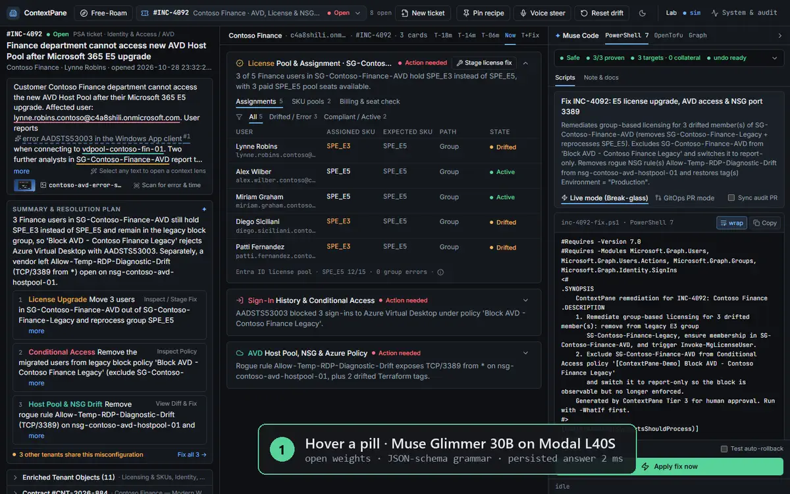
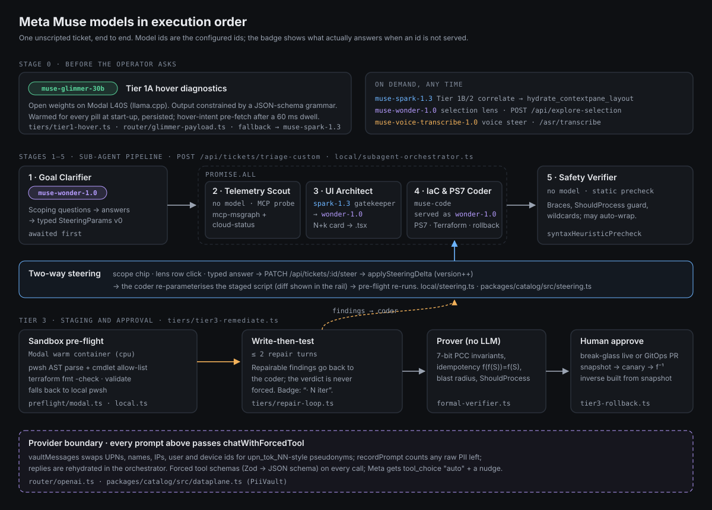
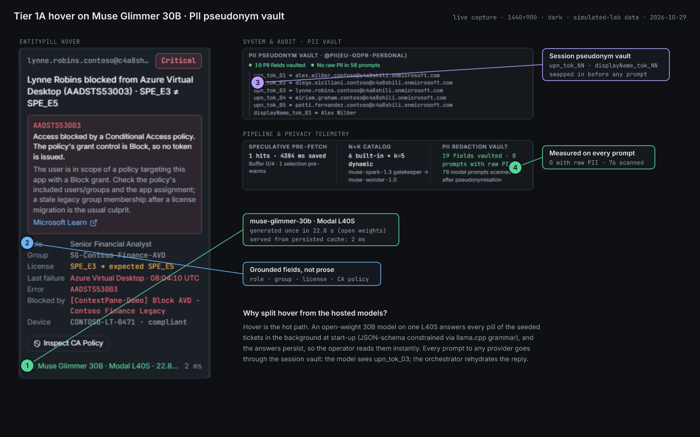
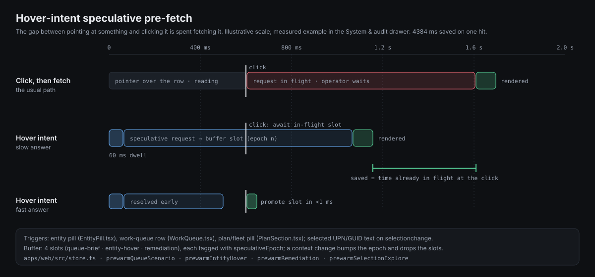
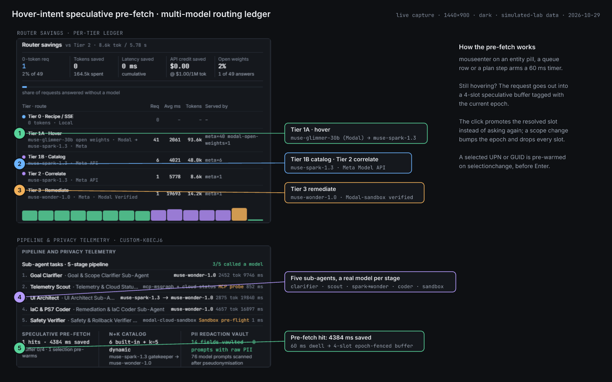
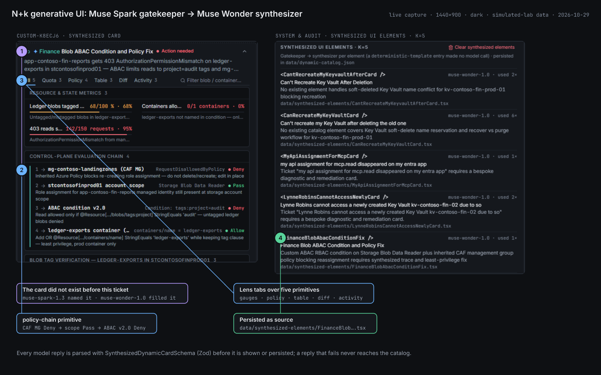
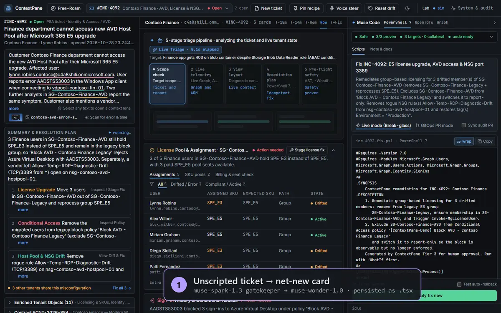
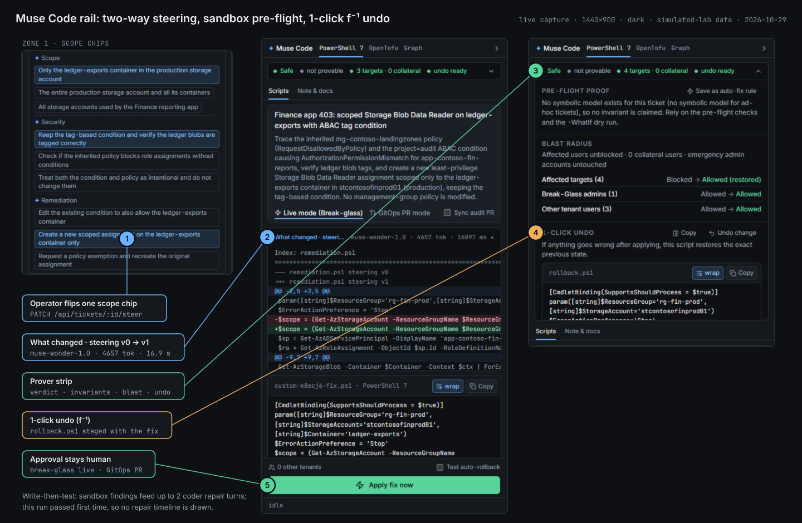
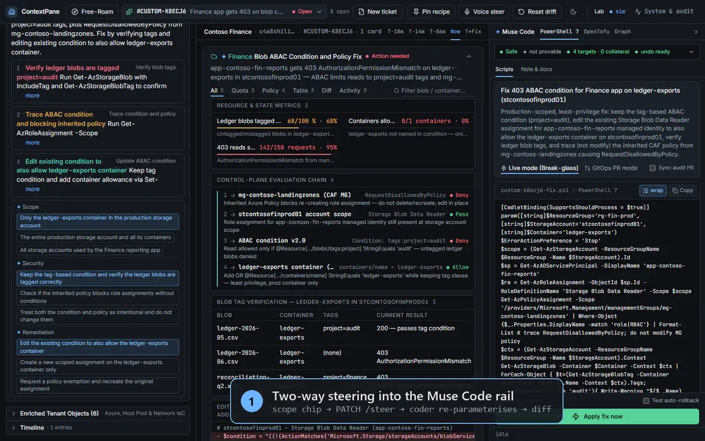
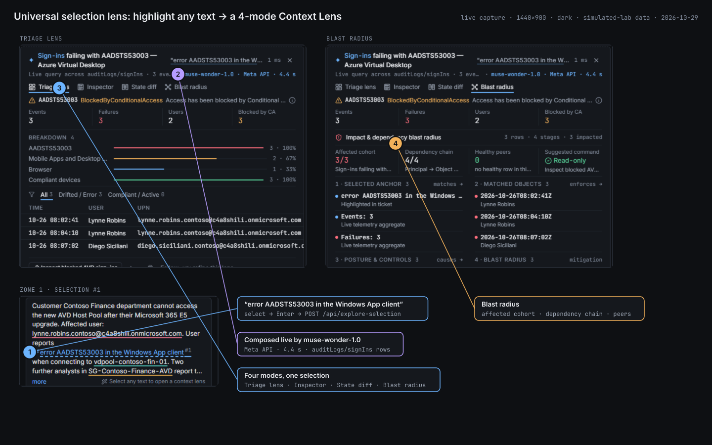

<div align="center">

# ContextPane

**An operator-steered remediation workbench for MSP engineers on Microsoft Entra ID, Intune and Azure.**

[](HACKATHON_ATTRIBUTION.md)
[](#3-meta-muse-models-in-execution-order)
[](modal-sandbox/README.md)
[](#6-quickstart-and-verification)
[](LICENSE)

</div>

> **ContextPane** correlates live multi-cloud tenant state with a vague support ticket. It traces the incident across Microsoft Entra ID, Intune and Azure ARM, composes any missing diagnostic UI on the fly with **Muse Wonder**, and stages sandbox-checked PowerShell 7 and Terraform fixes. Every fix comes with a 1-click inverse (f⁻¹), and nothing touches a tenant until a human approves it.

<p align="center">
  
  <br><sub>11.8 s loop, captured live from the running stack: ① Glimmer hover popover ② selection → Muse Wonder lens ③ scope chip → steering v1 → script diff in the Muse Code rail. A <a href="docs/assets/hero-flight-deck.gif">GIF fallback</a> is also included.</sub>
</p>

<p align="center"></p>

---

## Contents

1. [Hackathon compliance matrix](#1-hackathon-compliance-matrix)
2. [What ContextPane is not](#2-what-contextpane-is-not)
3. [Meta Muse models in execution order](#3-meta-muse-models-in-execution-order)
4. [Five systems deep dives](#4-five-systems-deep-dives)
5. [What is live, what is simulated](#5-what-is-live-what-is-simulated)
6. [Quickstart and verification](#6-quickstart-and-verification)
7. [Monorepo map](#7-monorepo-map)

---

## 1. Hackathon compliance matrix

| Field | Value |
|---|---|
| **Event** | Meta Global AI Developer Hackathon, 2026-10-26 → 2026-11-04 |
| **Track** | Indie Developer Track (solo entry: Timur Dudhasch, GitHub `dudhasch`) |
| **Themes** | *Build for Your World* (the author's own MSP operations work) · *Push the Frontier* (open-weight hover tier, generative UI under a schema, write-then-test agent loop) |
| **Meta models called** | `muse-glimmer-30b` (open weights, Modal L40S) · `muse-spark-1.3` · `muse-wonder-1.0` · `muse-voice-transcribe-1.0`. `muse-code` is configured but not served by the Meta Model API, so the router sends those calls to `muse-wonder-1.0` and reports the swap ([details](#model-stand-ins)) |
| **Provenance** | Built inside the hackathon window. See [HACKATHON_ATTRIBUTION.md](HACKATHON_ATTRIBUTION.md) |
| **License** | MIT |
| **Media** | Animated WebP/GIF loops and annotated PNGs in [`docs/assets/`](docs/assets). No video files in the repository |

### Bonus prize qualifications

| Bonus prize | What qualifies | Where in the code |
|---|---|---|
| **Best Build on Meta Open Weights** | `Muse-Glimmer-30B` GGUF (Q4_K_M) served by our own llama.cpp deployment on one Modal L40S. Output is constrained by a strict `json_schema` response format, which llama-server compiles to a GBNF grammar. It answers Tier 1A hover diagnostics; every answer is persisted with its real latency | [`modal-sandbox/glimmer_open_weights.py:139`](modal-sandbox/glimmer_open_weights.py#L139) (schema) · [`apps/orchestrator/src/router/glimmer-payload.ts:93`](apps/orchestrator/src/router/glimmer-payload.ts#L93) · [`apps/orchestrator/src/tiers/tier1-hover.ts:52`](apps/orchestrator/src/tiers/tier1-hover.ts#L52) (chain) · [`data/hover-cache.seed.json`](data/hover-cache.seed.json) |
| **Best Agentic Use-Case** | A 5-stage sub-agent pipeline (clarifier, MCP telemetry scout, Spark→Wonder UI architect, coder, verifier). Steering is two-way: any scope change re-parameterises the staged script. A write-then-test loop feeds sandbox findings back to the coder for up to 2 repair turns. Approval is human, and the inverse is built from a pre-change snapshot | [`local/subagent-orchestrator.ts:677`](apps/orchestrator/src/local/subagent-orchestrator.ts#L677) · [`local/steering.ts:165`](apps/orchestrator/src/local/steering.ts#L165) · [`tiers/repair-loop.ts:129`](apps/orchestrator/src/tiers/repair-loop.ts#L129) · [`tiers/tier3-rollback.ts:95`](apps/orchestrator/src/tiers/tier3-rollback.ts#L95) |
| **Best Creative Build** | N+k generative UI. When no catalog card fits a ticket, `muse-spark-1.3` names the missing element and `muse-wonder-1.0` fills it from five schema-checked primitives. The card is persisted as a `.tsx` file plus a catalog entry and rendered by the same React runtime as the hand-built cards | [`local/dynamic-catalog.ts:188`](apps/orchestrator/src/local/dynamic-catalog.ts#L188) (gatekeeper) · [`:285`](apps/orchestrator/src/local/dynamic-catalog.ts#L285) (synthesizer) · [`data/synthesized-elements/`](data/synthesized-elements) |

---

## 2. What ContextPane is not

| Common category | Why ContextPane is different |
|---|---|
| **A dashboard** | Dashboards display state. In ContextPane every view ends in an action. Each lens and plan step leads to a staged PowerShell 7 / Graph / Terraform change in the permanent 440 px **Muse Code rail**. The change carries a pre-flight verdict, a blast radius, an undo script and a human approve button |
| **A chatbot or RAG app** | There is no chat box. Models are called through forced tool schemas (Zod → JSON schema), and their output is validated before anything renders. Prompts carry pseudonyms, not identities. Answers bind to live MCP rows through `ptr://` pointers instead of prose |
| **An autonomous agent** | The agent proposes, checks and repairs; the operator steers and approves. Scope chips and lens-row clicks travel back into the coder (`PATCH /api/tickets/:id/steer`), and writes happen only from an explicit click |
| **A static demo** | Cards that do not exist are composed at triage time (see [§4.3](#43-self-expanding-nk-generative-ui)). The registry grew from k=4 to k=5 while these screenshots were being captured |

---

## 3. Meta Muse models in execution order

<p align="center"></p>

```mermaid
sequenceDiagram
    autonumber
    actor Op as Operator
    participant Web as Web (React 19)
    participant Orc as Orchestrator (Bun + Hono)
    participant MCP as MCP servers
    participant Gl as muse-glimmer-30b (Modal L40S)
    participant Meta as Meta Model API
    participant Box as Modal sandbox

    Note over Orc,Gl: start-up: warmHoverCache answers every pill once and persists it
    Op->>Web: hover a pill (60 ms dwell → speculative pre-fetch)
    Web->>Orc: POST /api/hover
    Orc-->>Web: persisted Glimmer answer (2 ms) or live chain
    Op->>Web: paste an unscripted ticket
    Web->>Orc: POST /api/tickets/triage-custom
    Orc->>MCP: Telemetry Scout probe (stage 2, runs throughout)
    Orc->>Meta: Goal Clarifier · muse-wonder-1.0 (stage 1)
    par stages 2-4
        Orc->>Meta: Gatekeeper · muse-spark-1.3 → Synthesizer · muse-wonder-1.0
        Orc->>Meta: Coder · muse-code (served as muse-wonder-1.0)
    end
    Orc->>Orc: Safety Verifier · static precheck (stage 5)
    Orc->>Box: pre-flight: pwsh AST + allow-list, terraform fmt/validate
    Box-->>Orc: findings
    loop write-then-test, ≤ 2 turns while repairable findings remain
        Orc->>Meta: coder repair turn
        Orc->>Box: pre-flight again
    end
    Orc-->>Web: SSE: card, script, verdict, proof
    Op->>Web: flip a scope chip
    Web->>Orc: PATCH /api/tickets/:id/steer
    Orc->>Meta: coder re-parameterises the staged script
    Orc-->>Web: steering v1 + script diff
    Op->>Web: approve (break-glass or GitOps PR)
    Orc->>MCP: pre-change snapshot → write → canary
    Op->>Web: 1-click undo → POST /api/rollback (inverse from snapshot)
```

| Stage | Model id (configured → answering) | Contract | Measured | Why this model here | Code |
|---|---|---|---|---|---|
| **0 · Hover (Tier 1A)** | `muse-glimmer-30b` on Modal; chain falls back to `muse-spark-1.3` | entity id → `HoverDiagnosticPopover` JSON (strict schema, GBNF) | 22.8 s to generate once; 2 ms from the persisted cache | Hover is the hottest path and the most repetitive. An open-weight model on our own GPU can answer every pill ahead of time at no per-call cost | [`tier1-hover.ts:218`](apps/orchestrator/src/tiers/tier1-hover.ts#L218) · warm-up [`:412`](apps/orchestrator/src/tiers/tier1-hover.ts#L412) |
| **1 · Goal Clarifier** | `muse-wonder-1.0` | ticket → clarifying questions → `SteeringParams` v0 | 9.7 s · 2,452 tok | Needs judgment over vague prose; its answers become the typed contract every later stage reads | [`subagent-orchestrator.ts:146`](apps/orchestrator/src/local/subagent-orchestrator.ts#L146) |
| **2 · Telemetry Scout** | none (MCP probe) | ticket + time → `UpstreamCloudStatusCorrelation` | 852 ms | Facts come from tools, not from a model | [`subagent-orchestrator.ts:677`](apps/orchestrator/src/local/subagent-orchestrator.ts#L677) |
| **3 · UI Architect** | gatekeeper `muse-spark-1.3` → synthesizer `muse-wonder-1.0` | ticket → `ElementRoutingDecision` → `SynthesizedDynamicCard` | 19.8 s · 2,875 tok | Spark is fast at classifying "which element is missing". Wonder writes the dense, domain-accurate card | [`dynamic-catalog.ts:188`](apps/orchestrator/src/local/dynamic-catalog.ts#L188) · [`:285`](apps/orchestrator/src/local/dynamic-catalog.ts#L285) |
| **4 · IaC & PS7 Coder** | `muse-wonder-1.0` (custom tickets); `muse-code` → `muse-wonder-1.0` in Tier 3B | ticket + typed steering → PS7 script, Terraform diff, rollback | 16.9 s · 4,657 tok (a steer turn) | The longest structured output; it re-parameterises an existing script rather than rewriting it | [`subagent-orchestrator.ts:354`](apps/orchestrator/src/local/subagent-orchestrator.ts#L354) · [`tier3-remediate.ts:189`](apps/orchestrator/src/tiers/tier3-remediate.ts#L189) |
| **5 · Safety Verifier** | none | script → repaired script + warnings | ≈1 ms | Deterministic: braces, `ShouldProcess` guard, wildcards | [`subagent-orchestrator.ts:465`](apps/orchestrator/src/local/subagent-orchestrator.ts#L465) |
| **Sandbox pre-flight** | none (Modal warm container, falls back to local pwsh) | bundle → verdict + findings | warm pre-flight ~0.7 s | Verifies what the coder wrote before an operator sees it | [`preflight/modal.ts:65`](apps/orchestrator/src/preflight/modal.ts#L65) · [`preflight/local.ts:293`](apps/orchestrator/src/preflight/local.ts#L293) |
| **Correlate (Tier 1B/2)** | `muse-spark-1.3` | 3 MCP sources → forced `hydrate_contextpane_layout` | avg 4.0 s (1B) / 5.8 s (2) | Layout selection over a fixed catalog: a classification task | [`tier2-correlate.ts:120`](apps/orchestrator/src/tiers/tier2-correlate.ts#L120) |
| **Selection lens** | `muse-wonder-1.0` → `muse-spark-1.3` | highlighted text → mini-dashboard spec | 4.4–4.8 s | Composes a new 4-mode lens from free text | [`explore.ts:115`](apps/orchestrator/src/tiers/explore.ts#L115) |
| **Voice steer** | `muse-voice-transcribe-1.0`, intent via `muse-spark-1.3` | 16-bit mono WAV → transcript → layout intent | n/a | Hands-free steering; ASR is `POST /asr/transcribe` | [`router/openai.ts:235`](apps/orchestrator/src/router/openai.ts#L235) · [`tiers/voice.ts:54`](apps/orchestrator/src/tiers/voice.ts#L54) |

Measured values come from the `CUSTOM-K8ECJ6` run and the router ledger captured on 2026-10-29 (see the [telemetry board](docs/assets/03-kinematic-prewarm-telemetry.png)).

#### Model stand-ins

At start-up [`router/meta-models.ts:11`](apps/orchestrator/src/router/meta-models.ts#L11) checks `GET /v1/models`. Any configured id the Meta Model API does not serve is swapped for its stand-in: `muse-glimmer-30b → muse-spark-1.3` on the Meta API, and `muse-code → muse-wonder-1.0`. The startup log and `GET /api/config` (`metaModelResolution`) report each swap. Glimmer therefore only ever runs as our Modal open-weight deployment, and every "Muse Code" label in the UI is served by `muse-wonder-1.0`.

---

## 4. Five systems deep dives

### 4.1 `ptr://` data plane and the PII pseudonym vault

<p align="center"></p>

**Pointers.** Correlated rows never travel inside a model prompt or a layout. Cards reference them by pointer ([`packages/catalog/src/dataplane.ts`](packages/catalog/src/dataplane.ts)):

| Version | Shape | Purpose |
|---|---|---|
| v1 | `ptr://inc-4092/entra/users` | dataset address (plane + dataset) |
| v2 | `…/entra/users?where=state:Drifted&select=upn` | relational filter. Equality only; anything else fails closed ([`parsePtrQuery`, :392](packages/catalog/src/dataplane.ts#L392)) |
| v3 | `…#tenant-contoso-01:<epoch>:<generation>` | fence ([`fencedDataPtr`, :264](packages/catalog/src/dataplane.ts#L264)). [`verifyPointerFence` (:285)](packages/catalog/src/dataplane.ts#L285) returns `valid · stale-epoch · cross-tenant · aba-generation-mismatch · unregistered-or-invalid`, and `GET /api/dataplane` answers 409 on any failure |

**Vault.** Every prompt to every provider goes through one function, [`chatWithForcedTool` (router/openai.ts:142)](apps/orchestrator/src/router/openai.ts#L142). It first runs [`vaultMessages` (:116)](apps/orchestrator/src/router/openai.ts#L116), which replaces UPNs, display names, public IPs, user ids and device names with session tokens (`upn_tok_03`, `displayName_tok_01`, …) from the process-wide [`PiiVault` (dataplane.ts:745)](packages/catalog/src/dataplane.ts#L745). `recordPrompt` counts any raw PII left, and the drawer shows the count. In the capture: **19 fields vaulted, 0 of 76 prompts with raw PII**. Model replies are rehydrated **in the orchestrator** ([:207](apps/orchestrator/src/router/openai.ts#L207)), so the browser shows real names and the provider never sees them.

**The 3-step MCP vault boundary** ([full trace on INC-4092](docs/traces/mcp-vault-boundary.md)):

| Step | Where | What crosses |
|---|---|---|
| 1 · Gather | [`gatherContext`](apps/orchestrator/src/mcp/context.ts#L118) → msgraph · azure-iac · erp | The orchestrator calls MCP itself, with real UPNs and GUIDs; no model picks the calls. Rows are published under fenced `ptr://` pointers |
| 2 · Outbound | [`contextForCorrelation`](apps/orchestrator/src/mcp/context.ts#L495) + [`vaultMessages`](apps/orchestrator/src/router/openai.ts#L116) | Descriptors without rows; identities as `upn_tok_NN`. In the trace: "Ticket from upn_tok_01", 8,155 characters, 0 raw PII hits |
| 3 · Inbound | [`depseudonymizeJsonText`](apps/orchestrator/src/router/openai.ts#L207) + [`resolveDataPtr`](apps/orchestrator/src/local/dataplane.ts#L318) | Tool args `{"targetEntityId":"upn_tok_01","dataPtr":"ptr://inc-4092/entra/users"}` become the real UPN in memory; the pointer resolves only through the fence (a cross-tenant check fails); rows sent back to a model are pseudonymised again ([explore.ts:170](apps/orchestrator/src/tiers/explore.ts#L170)) |

Models never issue MCP tool calls, and there is no service-principal or Activity Log hop: the `RequestDisallowedByPolicy` rows are fixtures (§5).

<p align="center"></p>

### 4.2 Hover-intent speculative pre-fetch

<p align="center"></p>

The store calls this the "kinematic speculative pre-warm". The mechanism is hover intent, not cursor physics: there is no velocity or deceleration model.

- **Trigger.** `mouseenter` on an entity pill ([`EntityPill.tsx:134`](apps/web/src/components/ticket/EntityPill.tsx#L134)), a work-queue row or a plan/fleet pill arms a 60 ms timer.
- **Speculative request.** If the pointer is still there when the timer fires, the request goes out into a **4-slot speculative buffer** whose slot kinds are `queue-brief`, `entity-hover` and `remediation`. Each slot is tagged with [`speculativeEpoch`](apps/web/src/store.ts#L383).
- **Click.** The click awaits the in-flight slot or promotes a resolved one instead of asking again.
- **Invalidation.** Any scope or tenant change bumps the epoch and drops every slot.
- **Selection pre-warm.** Selecting a literal UPN/GUID pre-warms the selection lens on `selectionchange`, before Enter.

The System & audit drawer reports hits, misses and milliseconds saved; one selection hit in the capture saved **4,384 ms**. Next to those counters is the per-tier routing ledger:

<p align="center"></p>

### 4.3 Self-expanding N+k generative UI

The catalog starts with hand-built cards (N). It grows by k whenever a ticket needs a view that does not exist:

1. **Gatekeeper.** `muse-spark-1.3` ([`assessTicketElementNeeds`, dynamic-catalog.ts:188](apps/orchestrator/src/local/dynamic-catalog.ts#L188)) names the missing element (`FinanceBlobAbacConditionFix`), its domain, the extracted entities and the reason.
2. **Synthesizer.** `muse-wonder-1.0` ([`:285`](apps/orchestrator/src/local/dynamic-catalog.ts#L285)) writes no code. It emits a **JSON view specification** composed of **five layout primitives**: `quota-gauges` · `policy-chain` · `data-table` · `config-diff` · `event-stream`.
3. **Gate.** The spec must parse as [`SynthesizedDynamicCardSchema`](packages/catalog/src/schemas/components.ts#L550) (Zod). A failing reply never reaches the catalog; the operator sees a labelled template card instead.
4. **Mount.** The web app's local interpreter, [`SynthesizedDynamicCard`](apps/web/src/components/cards/SynthesizedDynamicCard.tsx#L285), maps each block to a React primitive ([`renderBlock`, :116](apps/web/src/components/cards/SynthesizedDynamicCard.tsx#L116)). It runs no model-written code. The spec is stored with the triaged ticket (`synthesizedElements` in `data/custom-scenarios.json`). Drawing the card from a stored spec is client-side rendering and makes no model call.
5. **Persistence.** A passing spec is also exported as `data/synthesized-elements/<ElementId>.tsx`, a typed module that re-exports the schema and the spec so the card can be reviewed as source, and is added to [`data/dynamic-catalog.json`](data/dynamic-catalog.json). The System & audit drawer lists the registry.

Every data-table row in a synthesized card is steerable: clicking a row narrows the fix to that resource (§4.4).

<p align="center"></p>

<p align="center"></p>

> **Scope note.** `reuseCount` goes up when the gatekeeper names an element that already exists and Wonder re-synthesizes it ([`upsertCatalogEntry`, :273](apps/orchestrator/src/local/dynamic-catalog.ts#L273)). A *new* ticket gets no pre-synthesis lookup that serves a stored card; for custom tickets the gatekeeper always asks for a fresh element. Drawing from a stored spec without a model call applies only to a ticket that has already been triaged. No mount time has been measured.

### 4.4 Two-way steering and the write-then-test loop

<p align="center"></p>

**Steering contract.** [`SteeringParams`](packages/catalog/src/steering.ts#L37) is a typed object with fields `remediationStrategy`, `scope`, `governance`, `targetResource`, `targetIds`, `region`, `dryRun` and `answers`. Each value records its source (`clarifier · row-click · operator`). The object carries a version and an FNV-1a digest. A scope chip, a typed answer or a lens-row click sends a delta to `PATCH /api/tickets/:id/steer` ([app.ts:514](apps/orchestrator/src/app.ts#L514)):

1. [`applySteeringDelta`](apps/orchestrator/src/local/steering.ts#L165) bumps the version when the digest changes.
2. [`steerCustomTicket`](apps/orchestrator/src/local/custom-ticket.ts#L696) asks the coder to **re-parameterise** the staged script: keep its structure and change only the lines the steering requires.
3. The rail shows the diff ("What changed · steering v0 → v1").
4. [`restageRemediationForSteering`](apps/orchestrator/src/tiers/tier3-remediate.ts#L1029) re-runs the pre-flight.
5. A staged script older than the current steering shows a stale banner with a one-click Regenerate.

<p align="center"></p>

**Write-then-test.** Every bundle runs a pre-flight before the rail offers approval:

| Check | Modal warm container ([`contextpane_sandbox.py:283`](modal-sandbox/contextpane_sandbox.py#L283)) | Local fallback ([`preflight/local.ts`](apps/orchestrator/src/preflight/local.ts)) |
|---|---|---|
| PowerShell 7 AST parse + cmdlet allow-list / forbidden set | ✓ (persistent pwsh AST server) | ✓ `Parser::ParseFile` |
| `terraform fmt -check` · `terraform validate` (1.9.8, azurerm ~> 4.0) | ✓ | ✓ when the ticket has an HCL baseline |
| Mutating cmdlets inside `$PSCmdlet.ShouldProcess` | static check after either ([`checkWhatIfSafety`, :132](apps/orchestrator/src/preflight/local.ts#L132)) | same |

**The sandbox is offline and holds no tenant credentials.** Its only secret is the bearer token the orchestrator presents. It holds no Azure, Graph or Terraform state credentials. The Terraform working directory is set up at image build with `terraform init -backend=false`, and each bundle gets `fmt -check` and `validate`. It is Terraform 1.9.8, not OpenTofu, and nothing runs `plan` or `-WhatIf`.

**Live runs happen after Approve, as the engineer.** The live write runs on the orchestrator host, as the engineer's own delegated identity, and only with `LIVE_CLOUD_MODE=true`. The approved script itself runs only with `CTX_ALLOW_EXECUTE=true` ([`runScriptText`, tier3-remediate.ts:1130](apps/orchestrator/src/tiers/tier3-remediate.ts#L1130)). Approve does not run `-WhatIf` first. The `-WhatIf` dry run is the first command in the staged `REMEDIATION.md`, for the engineer to run in their own session.

[`runRepairLoop`](apps/orchestrator/src/tiers/repair-loop.ts#L129) feeds the repairable findings back to the coder, for at most [`MAX_REPAIR_ITERATIONS = 2`](apps/orchestrator/src/tiers/repair-loop.ts#L34) turns. Infrastructure findings (sandbox unavailable, Terraform missing, …) are not sent back. The loop stops early if the coder returns an unchanged script, and it never forces a verdict. The verdict badge then reads "· N iter" and the proof panel lists every round. The run in the screenshot passed on the first attempt, so no repair timeline is drawn; the loop is covered by [`repair-loop.test.ts`](apps/orchestrator/src/tiers/repair-loop.test.ts).

**Prover and f⁻¹.**
- [`formal-verifier.ts`](apps/orchestrator/src/local/formal-verifier.ts) checks seven invariants as a PCC bitmask ([`0x7f`, :84](apps/orchestrator/src/local/formal-verifier.ts#L84)): `break-glass-non-lockout`, `target-remediation`, `nsg-reachability`, `shadow-admin-zero-transitive`, `proactive-remediation-detect-read-only`, `idempotency-fork-isolated` and `bijective-inverse-rollback`. It also checks idempotency, f(f(S)) = f(S), on a forked state ([`:754`](apps/orchestrator/src/local/formal-verifier.ts#L754)). An ad-hoc ticket has no symbolic model, so the strip says "not provable" rather than claiming a proof.
- **Snapshot.** On a break-glass approve, [`captureEntitySnapshot`](apps/orchestrator/src/local/snapshot.ts#L107) records the touched users, groups, CA policies, NSG rules, Intune objects and workload identities.
- **Inverse.** [`buildInverseFromSnapshot`](apps/orchestrator/src/local/inverse-rollback.ts#L205) derives the inverse for only the sections the bundle changed.
- **Rollback.** [`rollbackRemediation`](apps/orchestrator/src/tiers/tier3-rollback.ts#L95) executes the inverse through the lab write path, reads the state back and compares it with the snapshot. "Restored" comes only from that read-back. Out-of-band changes are not checked *before* restoring: there is no ETag or hash precondition. An out-of-band edit to a snapshotted entity is written back to its pre-change value without a warning.

### 4.5 Zero-context correlation and universal selection lenses

<p align="center"></p>

**Correlation from a ticket alone.** A pasted ticket names a user and an error and nothing else, yet the orchestrator assembles the same context a senior engineer would:
- **Gather.** It probes three MCP servers in parallel:
  - **Graph** (`mcp-msgraph`): users, group licensing, Conditional Access, Intune.
  - **Azure** (`mcp-azure-iac`): NSG drift against the Terraform baseline, AVD estate, policy, regional quota.
  - **PSA** (`mcp-erp`): ticket, contract, billed seats.
- **Lay out.** It asks `muse-spark-1.3` for a layout over the fixed catalog, or builds a new card per §4.3.
- **Ground.** Entity pills in the ticket body become provenance-coloured hover targets.

**Selection lenses.** Highlighting 3–120 characters anywhere opens the selection trigger. Enter sends `POST /api/explore-selection` ([app.ts:341](apps/orchestrator/src/app.ts#L341)), and `muse-wonder-1.0` composes a lens with four modes: **Triage lens · Inspector · State diff · Blast radius**. The lens rows live under `ptr://<scenario>/selection/<hash>`, and the phrase stays marked in the ticket as `Selection #n`.

---

## 5. What is live, what is simulated

ContextPane labels its sources in the UI. The same rule applies here:

| Area | Live | Simulated or fixture |
|---|---|---|
| Graph (users, licensing extension, CA, Intune) | Live reads and approved writes against the seeded lab tenant `c4a8shili.onmicrosoft.com` with `LIVE_CLOUD_MODE=true` (Az token cache → Graph `$batch`) | Fabrikam Legal is manifest-only; the 15/15 CountViolation pool and devices are labelled fixtures |
| Azure ARM | NSG read/write + Terraform drift diff; regional quota (`westeurope` usages) in strict real-tenant mode | Policy compliance rows (including the `RequestDisallowedByPolicy` detail) are fixture rows; no Activity Log query exists |
| PSA / CSP | File-drop ERP inbox (`input/tickets/`), SLA clock | `mcp-erp` data, contracts and the "Billed (Pax8)" seat column are fixtures; there is no Pax8 integration |
| Models | Meta Model API calls and the Modal Glimmer deployment, with telemetry for every call | With no key every tier falls back to a labelled deterministic engine (`CTX_FORCE_LOCAL=true` forces it) |
| Verification | Credential-free Modal / local pwsh AST, `terraform fmt`/`validate` (`init -backend=false`); after Approve, live writes as the engineer's delegated identity | `-WhatIf` is a static ShouldProcess check in the sandbox and is never run by Approve; rollback has no ETag/hash precondition; canary probes and the blast-radius replay evaluate the symbolic model |
| Screenshots in this README | Real stack, real Meta and Modal calls | Data mode was `simulated-lab` (seeded fixtures plus live model calls); nothing was approved against the tenant during capture |

---

## 6. Quickstart and verification

**Prerequisites:** [Bun](https://bun.sh) ≥ 1.2, PowerShell 7; Terraform is optional (`winget install Oven-sh.Bun Hashicorp.Terraform`).

```bash
bun install
bun run dev
```

The orchestrator listens on http://127.0.0.1:4000 (`GET /api/health`) and the workbench on http://localhost:5173. Vite proxies `/api` and `/ws`.

| Mode | How | What you get |
|---|---|---|
| **Lab fixtures (no keys)** | nothing to configure | Every tier answers from the deterministic engine over `demo-iac/demo-lab-manifest.json` and the labelled fixtures |
| **Meta models** | `pwsh -NoProfile -File ./scripts/Set-ContextPaneRouterConfig.ps1` (writes git-ignored `.env.local`) or copy `.env.example` | `META_API_KEY`, optional `MODAL_INFERENCE_BASE_URL` (Glimmer) and `CTX_MODAL_SANDBOX_URL` (pre-flight) |
| **Live Entra / Azure tenant** | `Install-ContextPaneModules.ps1`, `Connect-AzAccount`, `Connect-ContextPaneGraph.ps1` (delegated CA/Intune write scopes), review and run `Invoke-SeedContextPaneLab.ps1`, then `LIVE_CLOUD_MODE=true` | Live reads; writes only from an approve click; `Remove-ContextPaneLab.ps1` tears it down |

```bash
bun run typecheck   # 6 workspaces, tsc --noEmit
bun test            # 278 tests across 44 files, 0 failures (2026-10-29)
bun run smoke       # pwsh smoke test of every tier endpoint and its Zod schema
```

**Hotkeys** (press `?` in the app): `Ctrl+K` work queue · `h` hover hero entity · `e` run step 1 · `d` diff · `f` open remediation · `x` approve · `u` explore selection · `c` clarifier · `t` router savings · `a` audit · `0` reset drift. The full list is in [`apps/web/README.md`](apps/web/README.md#hotkeys).

---

## 7. Monorepo map

```text
contextpane/
├── apps/
│   ├── orchestrator/        Bun + Hono API: router, tiers, sub-agents, steering, prover    → apps/orchestrator/README.md
│   └── web/                 React 19 + Zustand three-zone flight deck                     → apps/web/README.md
├── packages/
│   ├── catalog/             Zod contracts, ptr:// data plane, PII vault, steering schema  → packages/catalog/README.md
│   ├── mcp-msgraph/         Entra ID + Intune MCP server (live / lab)                     → packages/mcp-msgraph/README.md
│   ├── mcp-azure-iac/       Azure ARM + Terraform-baseline MCP server                     → packages/mcp-azure-iac/README.md
│   └── mcp-erp/             PSA tickets, contracts, billed seats MCP server               → packages/mcp-erp/README.md
├── modal-sandbox/           Modal apps: Glimmer 30B on L40S, pwsh + Terraform pre-flight  → modal-sandbox/README.md
├── data/                    N+k registry, synthesized .tsx cards, hover seed, skills      → data/README.md
├── golden-tenant/           declarative CA / Intune / app baselines cited by drift cards  → golden-tenant/README.md
├── demo-iac/                Terraform baseline (main.tf) + offline lab manifest
├── input/tickets/           ERP file-drop inbox (one seeded example)
├── scripts/                 PowerShell 7 lab seeding, config, smoke test, captures        → scripts/README.md
├── docs/                    visual assets, boundary traces, documentation index           → docs/README.md
├── DESIGN.md                Graphite & Signal design system
└── HACKATHON_ATTRIBUTION.md models, endpoints, provenance
```

- [apps/orchestrator](apps/orchestrator/README.md)
- [apps/web](apps/web/README.md)
- [packages/catalog](packages/catalog/README.md)
- [packages/mcp-msgraph](packages/mcp-msgraph/README.md)
- [packages/mcp-azure-iac](packages/mcp-azure-iac/README.md)
- [packages/mcp-erp](packages/mcp-erp/README.md)
- [modal-sandbox](modal-sandbox/README.md)
- [data](data/README.md)
- [golden-tenant](golden-tenant/README.md)
- [scripts](scripts/README.md)
- [docs](docs/README.md)

---

<sub>MIT © 2026 Timur Dudhasch. Screenshots and loops were captured from the running stack at 1440×900 in dark mode on 2026-10-29 and annotated with VectorCraft; the loops were encoded from CDP frame captures. Muse, Glimmer, Spark and Wonder are Meta model names used as served by the Meta Model API and the published open weights.</sub>
