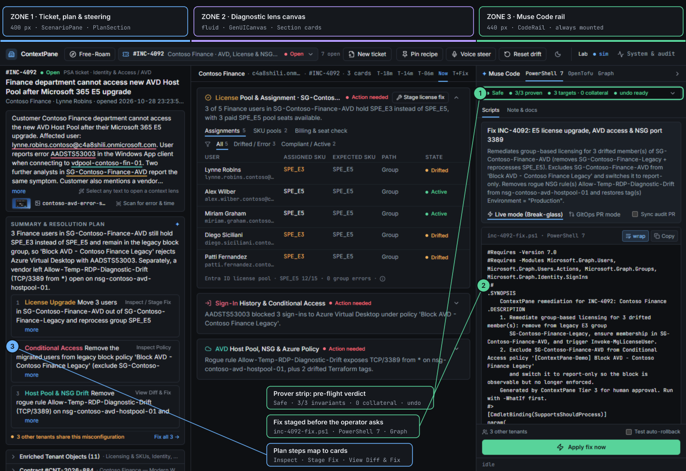

# @contextpane/web

The ContextPane **flight deck**: a React 19 + Zustand single-page workbench in three fixed zones. A ticket goes in on the left, the diagnostic lens renders in the middle, and the staged fix waits on the right.

<p align="center"></p>

```bash
bun run --filter @contextpane/web dev      # http://localhost:5173, proxies /api and /ws to :4000
bun run --filter @contextpane/web build
```

Stack: React ^19.2, Vite ^7.1, Tailwind ^4.1 (`@tailwindcss/vite`), Zustand ^5, Zod ^4.1, @floating-ui/react, lucide-react, Inter + JetBrains Mono. The theme is **Graphite & Signal**, defined as tokens in [`src/styles/tokens.css`](src/styles/tokens.css) (dark by default, light available, controlled by [`src/lib/theme.ts`](src/lib/theme.ts)); the spec is in [`DESIGN.md`](../../DESIGN.md).

## The three zones

| Zone | Width | Component | Contents |
|---|---|---|---|
| 1 · Ticket, plan & steering | 400 px default, draggable 340–520 ([`App.tsx:17`](src/App.tsx#L17)) | [`ticket/ScenarioPane.tsx`](src/components/ticket/ScenarioPane.tsx) (Free-Roam: `freeroam/TenantTree.tsx`) | ticket header and body with entity pills, summary and resolution plan, scope chips (Goal Clarifier), tenant objects and contract folds |
| 2 · Diagnostic lens canvas | fluid | [`canvas/GenUICanvas.tsx`](src/components/canvas/GenUICanvas.tsx) | catalog cards hydrated from the orchestrator's layout (Zod-validated), Muse-synthesized cards, selection lenses |
| 3 · Muse Code rail | 440 px open, 36 px collapsed ([`CodeRail.tsx:16`](src/components/shell/CodeRail.tsx#L16)) | [`shell/CodeRail.tsx`](src/components/shell/CodeRail.tsx) | PowerShell 7 · OpenTofu (HCL) · Graph · device-health tabs; modes `staging` · `review` · `console` · `note`; prover strip; approve footer |

The outer grid is `minmax(0,1fr) 1px <rail>px`, and the inner grid is `<left>px 1px minmax(0,1fr)` ([`App.tsx:69`](src/App.tsx#L69), [`:75`](src/App.tsx#L75)). The rail stays mounted, so a staged fix is never hidden behind a modal.

### Zone 1: ticket and steering

| Component | Role |
|---|---|
| `TicketHeader.tsx` · `TicketBody.tsx` | two-line header; customer text with entity underlines |
| `EntityPill.tsx` | provenance-coloured entity; a 150 ms hover opens the Tier 1A popover, and the pre-fetch fires after a 60 ms dwell ([`:134`](src/components/ticket/EntityPill.tsx#L134)) |
| `PlanSection.tsx` | summary, numbered resolution steps tied to cards, sub-agent status line, **scope chips**: a chip toggle calls `steer()` at once; "Update plan" re-runs the whole pipeline |
| `SelectionTrigger.tsx` | highlighting 3–120 characters offers "Generate Context UI" with four lens modes |
| `ContextFolds.tsx` · `ResolutionNote.tsx` | enriched tenant objects / contract; post-convergence PSA note |

### Zone 2: lens canvas

| Component | Role |
|---|---|
| `GenUICanvas.tsx` | mounts only catalog components the orchestrator returned |
| `Section.tsx` | the card frame (`CardShell` re-exports it); `DataTable` rows can be steering targets (`onRowClick`) |
| `LicenseDriftCard` · `EntraSignInTimeline` · `IntuneDriftCard` · `IaCDriftBanner` | the built-in catalog (N) |
| `cards/SynthesizedDynamicCard.tsx` | renders Muse-synthesized cards (k) from five primitives. A row click calls `steer({ rowClick })`, and the "Fix targets" line shows the current `targetResource` |
| `ContextualMiniDashboard.tsx` | selection lens with modes dashboard (Triage lens), full-card (Inspector), comparison (State diff) and blast-radius |
| `DiffModal.tsx` · `DiffView.tsx` | HCL / script diffs |

### Zone 3: Muse Code rail (`components/shell/rail/`)

| File | Role |
|---|---|
| `ScriptsTab.tsx` | action summary, execution-mode switch, **stale-steering banner + Regenerate**, **"What changed · steering vN → vM" diff** and the re-parameterising shimmer above the script |
| `StreamingScript.tsx` | line-by-line reveal while Tier 3 streams (`bundle:ready`, re-emitted after a repair turn) |
| `ProverStrip.tsx` | verdict (with "· N iter" after repair turns), invariants, blast radius, undo; expands to the proof, the **write-then-test timeline**, blast radius and the `rollback.ps1` |
| `ApproveFooter.tsx` | apply now / create PR / rollback drill; **"Revert now"** when the server reports an executable inverse, otherwise "Stage revert" |
| `LiveConsole.tsx` · `TraceTicker.tsx` | approval / revert output; last two progress events |
| `DiffReview.tsx` · `NoteAndDocs.tsx` · `OtherTenantsPopover.tsx` | inline review, customer note and runbook, fleet campaign across peer tenants |

## State (`src/store.ts`)

Zustand (`useWorkbench`). Key actions:

| Action | What it does |
|---|---|
| `correlate` · `remediate` · `approve` | Tier 1B/2, Tier 3 (SSE), HITL approval |
| `steer(delta)` ([`:2542`](src/store.ts#L2542)) | optimistic scope change → `PATCH /api/tickets/:id/steer` → `lastSteer` (diff, coder model/tokens/latency), `steerStatus` |
| `revertFromConsole` · `rollbackNow` | `POST /api/rollback`; the console reports only what the server did (executed / simulated / staged) |
| `prewarmEntityHover` · `prewarmQueueScenario` ([`:2156`](src/store.ts#L2156)) · `prewarmRemediation` · `prewarmSelectionExplore` | hover-intent speculative pre-fetch |

**Speculative buffer.** At most 4 slots (`queue-brief`, `entity-hover`, `remediation`), each tagged with `speculativeEpoch` ([`:409`](src/store.ts#L409)). A context change bumps the epoch and clears the buffer. The selection cache holds at most 8 entries. The System & audit drawer reports hits, misses and milliseconds saved.

`src/lib/api.ts` is the typed fetch layer for about 30 endpoints (`?stream=1` for SSE). `src/lib/ws.ts` subscribes to `/ws` telemetry.

## Hotkeys

`src/hooks/useDemoHotkeys.ts`; press `?` in the app for the overlay.

| Key | Action | Key | Action |
|---|---|---|---|
| `Ctrl/⌘ K` · `q` | work queue | `Ctrl/⌘ .` | toggle the code rail |
| `1`–`6`, `8`, `9` · `j` / `k` | pick / step queue items | `Esc` | close everything |
| `h` | hover the hero entity | `e` | run plan step 1 |
| `d` | diff | `f` | open the remediation |
| `x` | approve (or open the rail) | `p` | pin / unpin the view recipe |
| `u` | explore the selection | `c` | toggle custom scope inputs |
| `n` | ticket composer | `g` | simulate an ERP drop |
| `v` | voice steer | `7` | vision extract |
| `t` | router savings | `a` | audit log |
| `r` | fresh correlate | `0` | reset drift |

## Tests

`store.remediate.test.ts`, `store.timeline.test.ts`, `lib/format.test.ts` and `components/shell/rail/shared.test.ts` run in the root `bun test` suite.
