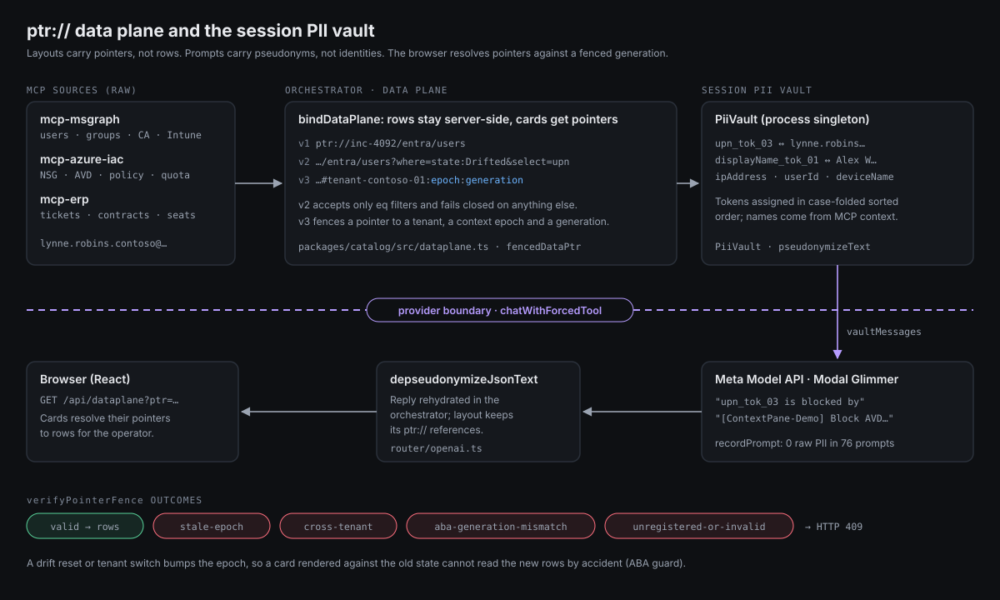

# @contextpane/catalog

The shared contract between the models, the orchestrator and the browser. Everything that crosses a boundary is a Zod schema here:
- a model's tool call
- a layout the canvas renders
- a pointer a card resolves
- a steering delta the operator sends

`apps/orchestrator`, `apps/web` and the three MCP servers import it as `@contextpane/catalog` (source-only, no build step).

| File | What it defines |
|---|---|
| [`src/schemas/primitives.ts`](src/schemas/primitives.ts) | severities, SLA tiers, `RouterTier` (Tier 0, 1A, 1B, 2, 3A, 3B, Voice, Vision), provider ids, provenance categories, `ExecutionMode` |
| [`src/schemas/components.ts`](src/schemas/components.ts) | every canvas card (`LicenseDriftCard`, `EntraSignInTimeline`, `IntuneDriftCard`, `IaCDriftBanner`, `HoverDiagnosticPopover`, `ActionApprovalDrawer` …), `VerificationStatus` with `RepairLoop` / `RepairRound` (`:318-347`), and the N+k `SynthesizedDynamicCardSchema` (`:550`) |
| [`src/schemas/layout.ts`](src/schemas/layout.ts) · [`recipe.ts`](src/schemas/recipe.ts) · [`mini-dashboard.ts`](src/schemas/mini-dashboard.ts) | the layout the canvas accepts (`ComponentTypeSchema` allow-list), pinned View Recipes (Tier 0), selection-lens specs |
| [`src/tools.ts`](src/tools.ts) | forced tool definitions: `hydrate_contextpane_layout`, `emit_hover_diagnostic`, `emit_remediation_bundle`, `steer_contextpane_layout`, `compose_contextual_mini_dashboard` (Zod → JSON schema) |
| [`src/validate.ts`](src/validate.ts) | `validateComponents`, `parseToolArguments`: every model reply is parsed here before anything renders |
| [`src/steering.ts`](src/steering.ts) | the two-way steering contract (below) |
| [`src/dataplane.ts`](src/dataplane.ts) | `ptr://` pointers, fencing, the PII vault (below) |
| [`src/aadsts.ts`](src/aadsts.ts) · [`permissions-dictionary.ts`](src/permissions-dictionary.ts) | AADSTS error translations (with Learn links); a role / Graph-permission dictionary with risk tiers, used by the role hover popover |
| [`src/tenants.ts`](src/tenants.ts) · [`scenarios.ts`](src/scenarios.ts) · [`labels.ts`](src/labels.ts) · [`sourceref.ts`](src/sourceref.ts) · [`actions.ts`](src/actions.ts) | tenant registry (Contoso Finance, Fabrikam Legal), scenario metadata, slug → label cleaning, git line provenance, quick actions |

## N+k card primitives

`SynthesizedDynamicCard.blocks` is a discriminated union over five primitives (`components.ts:430-537`):

| `kind` | Shape |
|---|---|
| `quota-gauges` | gauges with `used / limit / unit / status / detail` |
| `policy-chain` | ordered evaluation hops (scope, effect, condition) |
| `data-table` | typed columns + rows; optional `rowParamKey` makes rows steering targets |
| `config-diff` | unified diff with file path and language |
| `event-stream` | timestamped audit / activity events |

A synthesized card also carries `recommendedActions` (optionally with `setsParams` steering) and `synthesisMeta`: gatekeeper model, synthesizer model, latency, `tsxStubPath` and `source`.

## Steering contract (`src/steering.ts`)

| Export | Line | Notes |
|---|---|---|
| `SteeringParamsSchema` | [`:37`](src/steering.ts#L37) | `version` (bumped on every change), `digest`, `updatedAt`, `remediationStrategy`, `scope`, `governance`, `targetIds[]`, `targetResource`, `region`, `dryRun`, `answers`; every param is `{ value, label?, source, setAt }` |
| `SteeringSource` | `:15` | `clarifier \| row-click \| operator` |
| `SteeringDelta` | `:67` | `{ clarifier?, params?, rowClick?, source }` |
| digest | `:80` | FNV-1a over sorted values; timestamps and sources ignored |
| `isSteeringStale` | [`:102`](src/steering.ts#L102) | the staged script's `{version, digest}` against the current steering, which drives the rail's stale banner |

The orchestrator side (`applySteeringDelta`, `deriveSteeringFromAnswers`) lives in [`apps/orchestrator/src/local/steering.ts`](../../apps/orchestrator/src/local/steering.ts).

## `ptr://` data plane and the PII vault (`src/dataplane.ts`)

**Pointers.**

| Version | Format | Code |
|---|---|---|
| v1 | `ptr://<scenario>/<plane>/<dataset>`, e.g. `ptr://inc-4092/entra/users` | dataset keys `:17-33` |
| v2 | `?where=field:value,…&select=a,b&order=-field`; only equality, everything else fails closed | [`parsePtrQuery` `:392`](src/dataplane.ts#L392) |
| v3 | fragment `#<tenantId>:<epoch>:<generation>` | [`fencedDataPtr` `:264`](src/dataplane.ts#L264) |

[`verifyPointerFence` (:285)](src/dataplane.ts#L285) returns `valid · stale-epoch · cross-tenant · unregistered-or-invalid · aba-generation-mismatch`, and the orchestrator maps every failure to HTTP 409. Selection lenses use `ptr://<scenario>/selection/<hash>`.

**Vault.** [`PiiVault` (:745)](src/dataplane.ts#L745), with the process singleton `sessionPiiVault` (`:936`):
- **Fields.** It covers `upn`, `displayName`, `ipAddress`, `userId` and `deviceName`.
- **Tokens.** Values become `<field>_tok_NN` (for example `upn_tok_03`), assigned in case-folded sorted order within a batch.
- **Text.** `pseudonymizeText` (`:869`) handles emails, known person names (registered from MCP context) and public IPv4 addresses.
- **Metrics.** `recordPrompt` maintains the "0 raw PII in N prompts" metric (`zeroRawPiiInLlmPrompt`).

Each token also gets an epoch- and field-salted 64-bit FNV-style digest (`computeEpochSaltedDigest`, `:724`). Some fields are named `hmac…`, but it is a fingerprint, not a cryptographic MAC.

The orchestrator applies the vault to every prompt (`vaultMessages`) and rehydrates replies before they reach the browser.

## Tests

`catalog.test.ts`, `dataplane.test.ts`, `actions.test.ts`, `labels.test.ts` and `mini-dashboard.test.ts` run in the root `bun test`.
