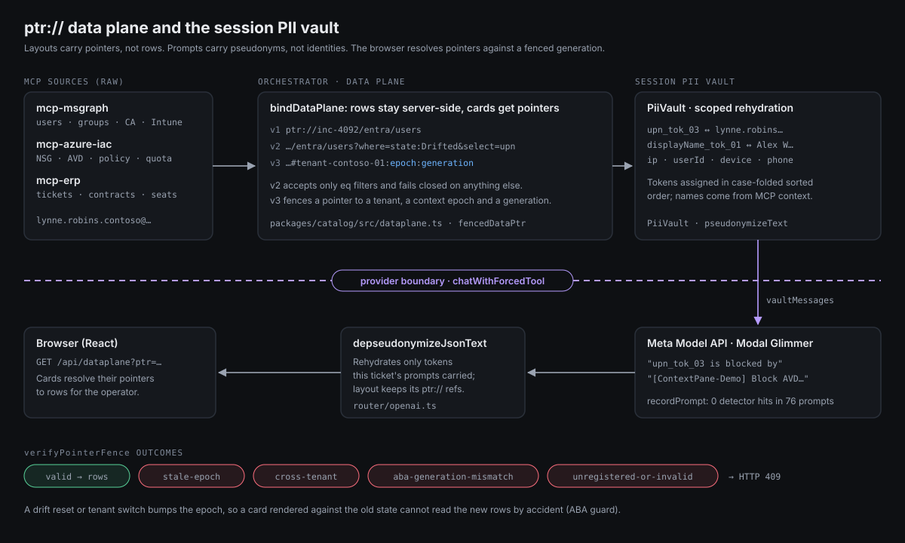

# @contextpane/catalog

The shared contract between the models, the orchestrator and the browser. Everything that crosses a boundary is a Zod schema here:
- a model's tool call
- a layout the canvas renders
- a pointer a card resolves
- a steering delta the operator sends

`apps/orchestrator`, `apps/web` and the three MCP servers import it as `@contextpane/catalog` (source-only, no build step).

| File | What it defines |
|---|---|
| [`src/schemas/primitives.ts`](src/schemas/primitives.ts) | severities, SLA tiers, `RouterTier` (Tier 0, 1A, 1B, 2, 3A, 3B, Voice, Vision), provider ids, provenance categories, `ExecutionMode` |
| [`src/schemas/components.ts`](src/schemas/components.ts) | every canvas card (`LicenseDriftCard`, `EntraSignInTimeline`, `IntuneDriftCard`, `IaCDriftBanner`, `HoverDiagnosticPopover`, `ActionApprovalDrawer` …), `VerificationStatus` with `RepairLoop` / `RepairRound` (`:319-348`), and the N+k `SynthesizedDynamicCardSchema` (`:574`) |
| [`src/schemas/layout.ts`](src/schemas/layout.ts) · [`recipe.ts`](src/schemas/recipe.ts) · [`mini-dashboard.ts`](src/schemas/mini-dashboard.ts) | the layout the canvas accepts (`ComponentTypeSchema` allow-list), pinned View Recipes (Tier 0), selection-lens specs |
| [`src/tools.ts`](src/tools.ts) | forced tool definitions: `hydrate_contextpane_layout`, `emit_hover_diagnostic`, `emit_remediation_bundle`, `steer_contextpane_layout`, `compose_contextual_mini_dashboard` (Zod → JSON schema) |
| [`src/validate.ts`](src/validate.ts) | `validateComponents`, `parseToolArguments`: every model reply is parsed here before anything renders |
| [`src/steering.ts`](src/steering.ts) | the two-way steering contract (below) |
| [`src/dataplane.ts`](src/dataplane.ts) | `ptr://` pointers, fencing, the PII vault (below) |
| [`src/preflight-rules.json`](src/preflight-rules.json) · [`preflight-rules.ts`](src/preflight-rules.ts) | the one pre-flight rule set both sandboxes enforce (below) |
| [`src/typed-actions.ts`](src/typed-actions.ts) | the typed action catalog an approval may execute instead of model-written PowerShell (below) |
| [`src/aadsts.ts`](src/aadsts.ts) · [`permissions-dictionary.ts`](src/permissions-dictionary.ts) | AADSTS error translations (with Learn links); a role / Graph-permission dictionary with risk tiers, used by the role hover popover |
| [`src/tenants.ts`](src/tenants.ts) · [`scenarios.ts`](src/scenarios.ts) · [`labels.ts`](src/labels.ts) · [`sourceref.ts`](src/sourceref.ts) · [`actions.ts`](src/actions.ts) | tenant registry (Contoso Finance, Fabrikam Legal), scenario metadata, slug → label cleaning, git line provenance, quick actions |

## N+k card primitives

`SynthesizedDynamicCard.blocks` is a discriminated union over five primitives (`components.ts:433-561`):

| `kind` | Shape |
|---|---|
| `quota-gauges` | gauges with `used / limit / unit / status / detail` |
| `policy-chain` | ordered evaluation hops (scope, effect, condition) |
| `data-table` | typed columns + rows; optional `rowParamKey` makes rows steering targets |
| `config-diff` | unified diff with file path and language |
| `event-stream` | timestamped audit / activity events |

A synthesized card also carries `recommendedActions` (optionally with `setsParams` steering) and `synthesisMeta`: gatekeeper model, synthesizer model, latency, `tsxStubPath`, `source` and, after a fallback, `fallbackReason`.

**Block provenance.** Every block has optional `provenance` (`tenant-data` · `mixed` · `model-estimate`) and `dataPtr` fields, and `data-table` blocks have `ungroundedRows` (indexes of rows that name nothing in the tenant context). The orchestrator sets all three from the ticket's tenant context; their schema descriptions say "Set by the orchestrator; leave unset", and the model's synthesizer tool does not offer them. A block without `provenance` predates grounding and the web app shows it as unverified.

## Steering contract (`src/steering.ts`)

| Export | Line | Notes |
|---|---|---|
| `SteeringParamsSchema` | [`:37`](src/steering.ts#L37) | `version` (bumped on every change), `digest`, `updatedAt`, `remediationStrategy`, `scope`, `governance`, `targetIds[]`, `targetResource`, `region`, `dryRun`, `answers`; every param is `{ value, label?, source, setAt }` |
| `SteeringSource` | `:15` | `clarifier \| row-click \| operator` |
| `SteeringDelta` | `:67` | `{ clarifier?, params?, rowClick?, source }` |
| digest | `:80` | FNV-1a over sorted values; timestamps and sources ignored |
| `isSteeringStale` | [`:102`](src/steering.ts#L102) | the staged script's `{version, digest}` against the current steering, which drives the rail's stale banner |

The orchestrator side (`applySteeringDelta`, `deriveSteeringFromAnswers`) lives in [`apps/orchestrator/src/local/steering.ts`](../../apps/orchestrator/src/local/steering.ts).

## `ptr://` data plane and the PII vault (`src/dataplane.ts`)

**Pointers.**

| Version | Format | Code |
|---|---|---|
| v1 | `ptr://<scenario>/<plane>/<dataset>`, e.g. `ptr://inc-4092/entra/users` | dataset keys `:17-33` |
| v2 | `?where=field:value,…&select=a,b&order=-field`; only equality, everything else fails closed | [`parsePtrQuery` `:392`](src/dataplane.ts#L392) |
| v3 | fragment `#<tenantId>:<epoch>:<generation>` | [`fencedDataPtr` `:264`](src/dataplane.ts#L264) |

[`verifyPointerFence` (:285)](src/dataplane.ts#L285) returns `valid · stale-epoch · cross-tenant · unregistered-or-invalid · aba-generation-mismatch`, and the orchestrator maps every failure to HTTP 409. Selection lenses use `ptr://<scenario>/selection/<hash>`.

**Vault.** [`PiiVault` (:786)](src/dataplane.ts#L786), with the process singleton `sessionPiiVault` (`:1019`):
- **Fields.** It covers `upn`, `displayName`, `ipAddress`, `userId`, `deviceName` and `phone`.
- **Tokens.** Values become `<field>_tok_NN` (for example `upn_tok_03`), assigned in case-folded sorted order within a batch.
- **Structured data.** `pseudonymize` vaults the PII fields of any object; `depseudonymize` reverses it. `registerPersonsFrom` remembers display names, user object ids and device names from MCP results, so free text naming them can be vaulted too.
- **Text.** `pseudonymizeText` (`:915`) handles e-mail addresses / UPNs, known person names, known device names, known user object ids (GUIDs), phone numbers and public IPv4 addresses. `scanForRawPii` reports the same kinds.
- **Scoped rehydration.** `depseudonymizeJsonText(json, allowed?)` turns tokens back into real values; with an `allowed` set, any token outside it stays a token and is counted in `refusedRehydrations`. `captureTokens(fn)` records the tokens `vault()` hands out while `fn` runs, and `exposeTokens(scope, tokens)` / `exposedTokens(scope)` track the tokens a tenant + ticket scope (`PiiScope`, keyed by `piiScopeKey`) has been given; `exposeTo(scope, text)` and `tokensIn(text)` remain for text built from vaulted data only. The router passes the tokens the vault itself put into the prompt (plus those the orchestrator's pre-vaulted context carried outside untrusted blocks), or the scope's accumulated set, as `allowed`: token-shaped text a customer wrote never widens it.
- **Token literals.** `stripTokenLiterals(text)` replaces anything shaped like a vault token (`<prefix>_tok_NN`) with `TOKEN_LITERAL_MARKER` (`[token-literal-removed]`); the orchestrator applies it to all customer-written text.
- **Metrics.** `metrics()` / `getPiiVaultMetrics()` return `piiFieldsVaulted`, `promptsScanned`, `detectorHits` (also as `rawPiiPromptHits` for older clients), `metricKind: "self-check"`, `refusedRehydrations` and the token map. `recordPrompt` re-runs the same detectors that did the replacement on each outgoing prompt, so `zeroRawPiiInLlmPrompt` is a self-check: it can only turn false if a replacement missed, and PII the detectors do not recognise is never counted.
- **Helpers.** `createPiiVault`, `pseudonymizeForLlm`, `depseudonymizeForLlm` and `getPiiVaultMetrics` (all default to `sessionPiiVault`). The old aliases (`tokenize`, `devault`, `lookup`, `unvaultValue`, `getMetrics`, `PseudonymVault`, `createPseudonymVault` and the like) are gone.

Each token also gets an epoch- and field-salted 64-bit FNV-style digest (`computeEpochSaltedDigest`, `:748`; read it with `digestForToken`). It is a fingerprint, not a cryptographic MAC, and is no longer named `hmac`.

The orchestrator applies the vault to every prompt (`vaultMessages`) and rehydrates replies, scoped as above, before they reach the browser.

## Pre-flight rules (`src/preflight-rules.json`)

One rule set for both pre-flight sandboxes: the local pwsh runner reads it through [`preflight-rules.ts`](src/preflight-rules.ts), and `modal-sandbox/contextpane_sandbox.py` reads the same JSON file, which the Modal image copies to `/root/preflight-rules.json`.

A command passes only when its verb is read-only, it is listed, the bundle's steered contract allows it, or the script defines it as a function. Everything else fails.

| Key | Rule |
|---|---|
| `readOnlyVerbs` | Get, Select, Where, ForEach, Sort, Group, Measure, Compare, Test, Join, Split, ConvertTo, ConvertFrom: any noun passes |
| `allowedCommands` | the scoped, non-privileged writes and output cmdlets the scenarios and strategies use (licence and Intune sync, NSG rule removal, Key Vault recovery, grant removals, `Write-*`, `Out-Null`, …); anything else with a hyphen fails ("Command outside allow-list") |
| `privilegedPatterns` | role grants, credentials, app permissions and owners, group adds, CA policy writes, device scripts, VM run commands, `Remove-AzKeyVault`, `Import-Module`: never in `allowedCommands`, a test asserts it; they pass only through the steered contract ("Privileged command outside the steered contract") |
| `inverseCommands` | what the repository's own inverse rollbacks use; never allowed in a forward bundle |
| `harmlessAliases` | `%`, `?`, `foreach`, `select`, …: the only hyphen-less commands that pass; native binaries (`pwsh`, `az`, `bash`, `curl`) fail |
| `forbiddenCommands` | any of these fails ("Forbidden command") |
| `forbiddenPatterns` | a password reset (`PasswordProfile`) or disabling a policy (`-State disabled`) fails whatever command carries it ("Forbidden command") |
| `destructivePatterns` | case-insensitive regular expressions, valid in JavaScript and Python; a match fails ("Destructive wildcard") |
| `deniedExecutionCommands` | commands that run code, open sessions, sign in or rebind the Az context; applied by `apps/orchestrator/src/preflight/execution-surface.ts` ("Execution surface:") |

`evaluatePreflightRules(commands, script, required, { allow, definedFunctions })` returns the findings for a command list (from the AST, or the text scan when no AST ran). `required` and `allow` are the steered contract: the scenario's or strategy's commands, computed by the orchestrator (`steeredRequiredCommands` / `steeredAllowedCommands`, `RemediationPlan.allowedCommands`), never the coder's own list. `isHardPreflightFinding` and `PREFLIGHT_HARD_FAIL_PREFIXES` mark which findings fail the bundle: every finding `evaluatePreflightRules` returns, every "Execution surface:" finding, and "PowerShell 7 not available" (no AST ran).

## Typed action catalog (`src/typed-actions.ts`)

The writes an approval may execute without running model-written PowerShell. `TypedActionSchema` is a discriminated union on `kind`:

| `kind` | `params` | Forward write | Inverse |
|---|---|---|---|
| `abac-conditioned-role-grant` | `container` (Azure container name) | ARM PUT of Storage Blob Data Contributor for the lab Function App identity on the payroll storage account, limited to one container by an ABAC condition (`conditionVersion 2.0`) | ARM DELETE of the identity's Storage Blob Data Contributor assignments on that account |
| `license-extension-remediate` | `tenantId`, `upns` (1–25 UPNs) | Graph `$batch` PATCH of the lab licence extension to SPE_E5 / Compliant | the same users back to the lab's drifted licence state |
| `nsg-baseline-restore` | `tenantId` | ARM reconcile of the tenant's lab NSG to its Terraform baseline | the NSG back to the seeded drift from `demo-lab-manifest.json` |

`TYPED_ACTION_DESCRIPTIONS` holds those descriptions for the approval drawer. `TypedActionSelectionSchema` is the forced-tool answer a model gives (`kind` or `"none"`, `params`, `rationale`), and `typedActionFromSelection` parses it into a `TypedAction`, or `null` with the schema issues. `ActionApprovalDrawer.typedAction` carries the chosen action. The validators and executors live in `apps/orchestrator/src/execution/typed-actions.ts`.

## Tests

`catalog.test.ts`, `dataplane.test.ts`, `actions.test.ts`, `labels.test.ts` and `mini-dashboard.test.ts` run in the root `bun test`. The vault's scoping and the pre-flight rules are also covered from the orchestrator side (`router/pii-vault.test.ts`, `preflight/local.test.ts`).

**Audit entries.** `AuditEntrySchema` carries the ledger's hash chain (`prevHash`, `hash`) and `identitySource` (`host-graph-signin` · `configured-default` · `system`); `AuditChainStatus` is what `verify()` returns. Telemetry events (`RouterTelemetrySchema`) carry `savingKind` (`cache-hit` · `recipe` · `compiled-skill`) on the requests that really avoided a model call; only those count as savings.
